**English** · [Türkçe](README.tr.md)

TM Concept is a free, open-source (MIT) desktop app that turns a channel idea into video concepts and short videos with
**online AI models and your own API keys**. It runs on Windows and Linux and keeps its database encrypted on your computer.

> Work in progress. Installation and usage guides are added before the first release.
