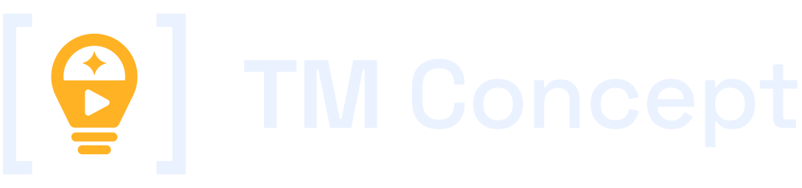

<p align="center"></p>

**English** · [Türkçe](README.tr.md)

TM Concept is a free, open-source (MIT) desktop app that turns a channel idea into video concepts and short videos. It writes concepts
with **online AI models and your own API keys**, lets the model write the video code, renders the video **on your computer** (no GPU
needed) and narrates it with a **free local voice**. It runs on Windows and Linux and keeps its database encrypted.

- [What it does](#what-it-does)
- [What it costs](#what-it-costs)
- [Install on Windows](#install-on-windows)
- [Install on Linux (x64 and arm64)](#install-on-linux-x64-and-arm64)
- [First start](#first-start)
- [Models and what they install](#models-and-what-they-install)
- [API keys](#api-keys)
- [Make your first video](#make-your-first-video)
- [Update](#update)
- [Uninstall](#uninstall)
- [Where your data is](#where-your-data-is)
- [Licenses you should know](#licenses-you-should-know)
- [Known limits](#known-limits)
- [Build from source](#build-from-source)

## What it does

- **Profiles = channels.** Channel name, video language (Turkish, English, German, Spanish, French, Italian, Portuguese, Dutch, Polish,
  Russian, Swedish or Indonesian; your notes may stay in your own language, the video is written in this one), vertical short or horizontal video, target length
  (15–180 s), the channel's concept in your words, an optional channel photo (a round avatar for the closing
  end card), and its own models for any step (voice, images, engine…) where it should differ from the general setting. The photo
  can be added while the profile is new; it is copied when you save. Four ready profile templates fill the fields
  (history: Byzantine, Ottoman; technology: ancient, modern).
- **Video templates** (Settings → **Templates**, at most 20, not tied to a profile): the identity of the videos and how they end. Subtitles
  on or off, a progress bar drawn by the app (off by default), one of six free fonts with Turkish letters, the title style and its place on
  a 3×3 grid, a colour palette, who draws, the narration tempo, the quality mode, and a closing call to action ("Don't forget
  to subscribe for more videos!"; *subscribe* for YouTube, *follow* for Instagram and TikTok) in the narration, on screen, both or off,
  always in the video's language. The form shows a live preview. Each video takes a copy of its template when it starts, so editing or
  deleting a template never changes a made video. The drawing style, motion and finishing are not in the template: they are the
  profile's **look** on the Concept to video page (below).
- **Generate concepts.** Four separate sections, used in any order; each one adds to the same list. **Generate from suggested topics**: suggest 5–100 topics, tick the ones you like and
  press **Generate selected**: exactly one concept per ticked topic. A topic you did not tick is not a bad one: it may be suggested again
  later; only a topic that got a concept never comes back (topics suggested before 0.1.18 stay blocked: that version did not record which
  ones got a concept). **Generate from an idea**: write an idea (or leave it empty) and
  choose 1–100 concepts. Every press adds to the list. Every concept comes with its scenes (about one every 13.5 s of the target
  length); a concept with missing scenes gets one automatic repair and, when it still lacks them, is marked and asks before approval. Each button shows a small estimated price; the exact price from the provider's
  usage follows. Duplicates are prevented in four layers: the history of every concept in the prompt (cached), a free local similarity
  check, an optional semantic check with an embedding model, and a compressed history when the list grows. Every row has **Approve**
  (key A) and **Delete** (key D); a click opens the concept in the detail panel beside the list. Deleted concepts stay in **Trash**
  forever (they still count against duplicates) until you delete them permanently.
- **From documents** (the third section, 0.1.21). **My documents** holds the profile's own sources: PDF, Word (.docx), text and Markdown
  files, a web page (its readable text, fetched once; no script runs) or a Wikipedia article in any language (by its address, or by its
  title and a language code; only public addresses: an address on this computer or the local network is refused, also after a redirect,
  and a page has 30 seconds in all). The app keeps its own copy of each one in its data folder (not encrypted); the text, cut into
  passages, is in the encrypted database. Documents belong to the profile they were added in; deleting a profile deletes its copies. Write an optional subject and choose how many: **Write from
  documents** writes that many concepts at once, or **Find topics** looks for that many topics in the documents first and the button then
  writes one concept per ticked topic. Each call gets only the passages that fit the model's context (a small local model with an 8k
  context gets about 3–4 thousand tokens of passages, a lower answer limit and, when even that is not enough, fewer concepts per call; a
  paid model at most 12 thousand tokens per call, so a big context does not cost much). Passages in another script (Japanese, Russian,
  Greek…) are counted on the safe side, headings and titles included. A long run, and every new press without a subject, reads other
  parts of the documents instead of the same passages; a found topic is searched in the documents it came from, with search words in
  their language. The prompt tells the model to use only the documents' facts and to name the documents it used (the
  detail panel shows them as *Sources*); the concepts are written in the video's language even when the documents are in another one.
  Passages are picked by their words (BM25; a suffixed word also finds its stem, "Osmanlıların" finds "Osmanlı") and, when you install the optional meaning search (multilingual-e5-small, about 135 MB,
  downloaded only after you confirm it, run on this computer's processor), also by meaning. **Scanned pages** are read automatically: a
  page without a usable text layer (a scan, text drawn as shapes, or a layer of broken characters) is drawn whole by PDFium (0.1.27, about
  4 MB, optional, offered the first time scanned pages are read; it also reads JPEG 2000, JBIG2 and CCITT fax scans and turned pages) and read
  by the engine of *Text from scanned pages*: the local OCR (PaddleOCR PP-OCRv5, free, on this computer; used when no engine is chosen)
  or a vision model. On Windows the local OCR reads on the graphics card when it is free (DirectML, any make of card; an optional ~15 MB
  download under Microsoft's DirectML licence, offered once; a page never waits more than two seconds for the card, so a video or a
  local model keeps it), otherwise on the processor; Settings → General → *Text recognition* can keep it on the processor. Pages read
  once are kept with the document and never read again; **Write from documents** and **Find topics** first read the pages of the chosen
  documents that are still missing. Settings → **Storage** lists every document; neither **Clean up unused** nor **Full delete** takes one;
  ticking its row or a document's **Delete** deletes its copy and passages for good (nothing is removed while a document is being added).
  Backups carry the documents with the profiles (the records, the passages and the copies; the copies up to 256 MB per backup, the smallest
  first: the copies past that are left out, logged, and their records and passages are still in the backup).
- **From research** (the fourth section, 0.1.22). The app researches a subject itself; no model searches the web on its own, so there is
  no hidden search cost. **Search** asks Wikipedia (any language) and Wikidata (facts: dates, places, people), both free and without a
  key, plus the addresses you type under *Options* and, if you set them up under **Settings → Research**, Tavily with your own key or
  your own MCP servers. It reads the profile's language, English and up to two more languages: the ones you add and the ones the subject
  points at (Greek for Byzantium, Persian for the Safavids, Turkish for the Ottomans; at most four in all). Only the profile's language
  and English are searched; the other languages are reached through the found articles' language links, so the same entity is read in
  its own Greek article. One entity in many languages is one source group (by its Wikidata item). **Search** only lists the pages it
  would fetch, ticked by the plan (your own addresses first, about a third of the rest in the other languages; with only one or two
  *Pages* the profile's language and English come first); nothing is fetched and no model is called. Change the subject, the addresses
  or the languages afterwards and the button asks for a new search; tick more pages than *Pages* and it asks you to untick some or raise
  the number. The button then fetches the ticked pages (at most 12, 4 MB and two minutes in all; cancellable; each step in the activity
  panel) through the same guarded fetching as **My documents**, saves them there (passages, meaning search) and writes the concepts from
  them alone, in the video's language, naming the pages they used (*Sources*). Text on a fetched page is data: invisible characters that
  hide or reorder text are removed (from every document, PDFs too), and the page sits inside the prompt's data block, so it cannot give
  the model orders. A page that Tavily or an MCP server found is fetched only when the site's robots.txt allows it; an address you typed
  is fetched as you asked. The fetching is kind to the free services: one request at a time per site, a "please wait" answer is honoured
  once, and every request names the app and its project page (as Wikimedia asks), nothing about you. Untick **Keep in My documents** to
  delete the pages a run added afterwards, also when the run is canceled or fails midway. The model may be online or
  local: the passages are fitted into its context like any document's.
- **Concept to video.** Approved concepts on the left (a click opens one under the list, where it can be edited by hand or with AI),
  **Add to queue**, then **Produce in order**. The models (code with its engine, images, voice) are one folded line on top, next to the
  **template** (empty on a new install: nothing is produced until a code model and a template are chosen). While a video
  is made, every step shows with its time and cost, the code model's tokens and what was paid so far. The made videos are on the right
  with a preview player, **Open in player**, **Open folder** and **Fix the concept, produce again**. The model writes one code file; a
  safety check runs before anything is executed (with scene images the code must show them); a failed check or render gets one repair
  request (a local code model gets the app's own animation instead). After the render one frame of every scene is checked: a local
  model's video that shows an empty frame or not its image is rendered again with the app's own animation; an online model's video stops
  only when most scenes fail (no paid repair), otherwise it is kept with a warning. Videos are at most 3 minutes.
  **When a video fails, the whole queue stops** (the error is on the page, in a notification and in red in the activity panel; start the
  queue again when it is fixed). **Night mode** (the checkbox next to **Produce in order**, off at every start, may be ticked while the
  queue runs) is for when you are not at the computer: a failed video is reported and the next one is made, 10 seconds pass between videos,
  a lack of memory fails that video instead of asking, and 3 failed videos in a row stop the queue completely (so no money is wasted).
- **Produced videos.** Thumbnail, a built-in player (play/pause, seek bar, time, volume, full screen; nothing starts by itself), the whole
  narration scene by scene and the whole concept text, details (engine, models, cost per step, voice notes), open in the system player,
  open the folder, produce again, delete a version (with its files, for good; the confirmation shows the size).
- **Rate your videos.** **👍 I liked it** / **👎 I didn't like it** under the preview (Produced videos and Concept to video); pressing the
  same button again clears it. One vote counts for all versions of a video. The next topic and concept suggestions stay away from a
  disliked video's topic and close ones, and take a liked one as an example (similar spirit, different topics). Making a video is not a
  like; an unrated video only counts as done. The vote stays when the concept or the video is deleted.
- **This month's spending** stays at the top left; while paid work runs it shows what is being spent now.
- **Versions.** Edit the narration of each scene (more sentences, placeholders for pauses, speed and transitions) and choose a voice: the voice is made again on
  your computer and the same video code is rendered again — no AI cost (an online voice is paid). Or have new code written for another
  engine (the estimate is shown and confirmed first); images, voice clips and texts are used again. Every new version is a folder of its
  own (v2, v3…); the older ones stay.
- **Notifications** in the bottom-right corner (concepts ready, video ready, error). One minute by default; change or turn them off in
  Settings. A notification also says what failed and what was spent; everything the app does is written to the log file.
- **Encrypted.** The database (with your API keys) is encrypted with SQLite3 Multiple Ciphers. Its key is protected by Windows (DPAPI), the
  Linux keyring or a master password. Daily backups (last 10) are password-protected files (Argon2id + AES-256-GCM); you choose what goes
  in (API keys only when you tick them).
- **Two interface languages:** English and Turkish.

It does **not** read other channels and does not use reference videos. It can speak videos with **your own voice** (Pocket TTS for English,
Chatterbox Multilingual V3 for Turkish and nine more languages, from a short recording you add; whose voice you copy is your
responsibility).

## What it costs

The app is free. You pay your AI providers directly, only for what you use; the app shows the estimate before and the exact cost after.
Rough numbers (prices of 5 Nov 2026; the pages show the current ones next to each estimate — they update by themselves):

| What | Typical cost |
|---|---|
| 20 concepts with Claude Sonnet 5.5 | about 0.15–0.25 $ |
| Video code for one 60–90 s video with Claude Sonnet 5.5 | about 0.10 $ |
| Narration with a local voice (Supertonic 3, or Kokoro for English) | free |
| Duplicate check by meaning with the local model | free |
| 8 AI images per video (fal FLUX 2 Flash) | about 0.08 $ |
| 8 images with a local model (FLUX.2 klein, FLUX.3 Image Klein, Z-Image Turbo, Qwen-Image…; your graphics card) | free |

## Install on Windows

Windows 10 or 11, 64-bit. There are two editions with the same features. Both use the same data folder, so models and
settings one installed are there for the other, and only one copy runs at a time.

| Download from the [latest release](../../releases/latest) | Edition |
|---|---|
| `TMConcept-win-x64-Setup.exe` | **Installed (recommended):** Start menu and desktop shortcuts, listed in Windows' *Apps*, updates download only what changed. |
| `TMConcept-Portable-win-x64.exe` | **Portable:** a single program file, nothing installed; it replaces itself when it updates. |

The `.nupkg` and `releases.win-x64.json` files of a release are for the installed edition's updates; you never download them yourself.

**Installed edition**

1. Download `TMConcept-win-x64-Setup.exe`. Optional but recommended: check it against the SHA-256 value in the release notes. In PowerShell:
   ```powershell
   Get-FileHash .\TMConcept-win-x64-Setup.exe -Algorithm SHA256
   ```
2. Double-click it. Setup is not code-signed, so Windows shows **"Windows protected your PC"** (SmartScreen): click **More info**, then
   **Run anyway**. It installs for your user only (no administrator rights) into `%LOCALAPPDATA%\TMConcept`, adds the shortcuts and opens
   TM Concept.
3. Continue with [First start](#first-start).

**Portable edition**

1. Download `TMConcept-Portable-win-x64.exe` and check its SHA-256 the same way.
2. Put the file where it can stay, for example `%LOCALAPPDATA%\Programs\TM Concept\TMConcept-Portable-win-x64.exe`, and double-click it
   (SmartScreen as above; Windows usually asks only the first time).
3. To switch to the installed edition later: Settings → General → **Install TM Concept** downloads this version's Setup from the same
   release, checks it against the release notes' SHA-256, runs it and closes the portable copy (the file stays where it is; delete it if
   you like). It never runs an older or the same Setup over an installed TM Concept.

No administrator rights are needed in either edition; nothing is installed system-wide and the system PATH is never changed. Settings →
General → *Edition* shows which one runs, its version and (installed) its folder.

**OneDrive note:** videos are saved in `Documents\TM Concept`. If OneDrive backs up your Documents folder, every video is uploaded to the
cloud too. If you do not want that, exclude the folder in OneDrive's settings.

## Install on Linux (x64 and arm64)

Use `linux-x64` on ordinary PCs and `linux-arm64` on 64-bit ARM computers (for example a Raspberry Pi 4 or 5 with a 64-bit desktop). A
desktop session is required.

1. Download `tm-concept-portable-linux-x64.tar.gz` (or `tm-concept-portable-linux-arm64.tar.gz`) from the
   [latest release](../../releases/latest).
2. Optional: check the SHA-256 value: `sha256sum tm-concept-portable-linux-x64.tar.gz`
3. Unpack it where it can stay:
   ```sh
   mkdir -p ~/.local/opt
   tar -xzf tm-concept-portable-linux-x64.tar.gz -C ~/.local/opt
   ~/.local/opt/tm-concept/install-desktop-entry.sh   # optional: adds TM Concept to the application menu
   ```
4. **Keyring (recommended).** To open the database automatically, the key is stored in your desktop keyring with `secret-tool`:
   Debian / Ubuntu / Raspberry Pi OS: `sudo apt install libsecret-tools` · Fedora: `sudo dnf install libsecret` · Arch:
   `sudo pacman -S libsecret`. Without a keyring the app asks a master password at every start.
5. **Chrome's libraries.** The video engines run a headless Chrome. If libraries are missing, Settings → General (Installed components) shows the exact
   `sudo apt install …` command (the app never uses root). Typical list: `libnss3 libatk-bridge2.0-0 libcups2 libdrm2 libxkbcommon0
   libxcomposite1 libxdamage1 libxrandr2 libgbm1 libpango-1.0-0 libasound2`.
6. **ARM64:** Puppeteer has no ARM64 Chrome. Install Remotion (it brings its own ARM64 browser) or the system Chromium
   (`sudo apt install chromium`); HyperFrames and Revideo then use it.
7. Start `~/.local/opt/tm-concept/tm-concept` (or from the menu).

## First start

1. **Language:** two big buttons, Türkçe and English (your system language comes first). You can change it later in Settings.
2. **New start or restore:** shown only when there is no data yet. *Restore from backup* asks for a `.tmcbak` file and its password, then
   shows what the file holds (profiles, concepts, settings, API keys if they were backed up) and asks before restoring.
3. **Protection and backup password:** the database key is protected by Windows / the keyring, or by a master password. The **backup
   password** is required (at least 12 characters): daily backups are encrypted with it. Write it down; without it a backup cannot be opened.
4. **First profile:** choose a template or fill in your channel.

**Help on every page.** A small **?** sits to the right of features, settings and sections (the Concepts sections and their options,
the video queue and templates, every Settings page, the components, storage, research and MCP, the log filters, the update and install
windows). Hover it, or reach it with Tab, for a one-line tip; click it, or press Enter or Space, for a short explanation of what it does
and how to use it.

## Models and what they install

There is no model setting in Settings: every model is chosen on the page that uses it, and the last choice is kept **per profile** (a
new profile starts with nothing paid chosen; "Recommended" shows the suggested ones). **Generate concepts** has the concept model and the
duplicate check by meaning; **Concept → video** has the video code model with the engine, images and narration. Each step says what it is
for:

- **Concept generation** and **Video code** — the online models you pay for. **Effort** appears only for a model that takes one; *Automatic*
  sends no effort (the provider's default). **Video code** also has the **video engine**: HyperFrames (default), Remotion (asks you to
  accept its license: free for individuals and companies of up to 3 people), Revideo (experimental). The video code model also writes
  the image prompts.
- **Images** — *Off* (default: the video is drawn by its code only), an online image model, or one of 20 local ones that run on your
  graphics card, each in a graphics memory class (the list shows it; green = your card runs it, red = "this card cannot run it", and such a
  model is never downloaded):
  - **4 GB**: Z-Image Turbo (small), FLUX.2 klein 4B (fastest), SDXL Lightning
  - **6 GB**: Z-Image Turbo, FLUX.3 Image Klein, Stable Diffusion 3.5 Medium, SDXL Lightning (Q8), Qwen-Image 2.1 Turbo (**non-commercial**)
  - **8 GB**: FLUX.2 klein 9B (**non-commercial**)
  - **12 GB**: Z-Image Turbo (Q8), FLUX.2 klein 4B (Q8), Stable Diffusion 3.5 Medium (Q8), Qwen-Image 2.1 Turbo (Q8, **non-commercial**)
  - **16 GB**: Qwen-Image (strong at text in pictures), FLUX.3 Image Klein (Q8), Qwen-Image 2.1 (**non-commercial**)
  - **24 GB**: Z-Image Turbo (full quality), FLUX.2 klein 9B (Q8, **non-commercial**), Qwen-Image (Q6)
  - **32 GB**: Qwen-Image (Q8)

  A model is downloaded only when you choose it and confirm. Licenses: most are Apache-2.0 (free for any use); **FLUX.2 klein 9B and Qwen-Image 2.1
  (Qwen Research License) are non-commercial** (orange badge: not for monetized videos; red only ever means "this card cannot run it"); FLUX.3 Image Klein (FLUX Kommunity License: by Black Forest Labs' announcement free
  commercial use under 5 million USD annual revenue), Stable Diffusion 3.5 Medium (Stability AI Community License: under 1 million USD) and
  SDXL Lightning (OpenRAIL++ use restrictions) have conditions (yellow badge). Each of these asks you to accept its license once, before its
  first download. Before every picture the app measures the card's **free** memory: the VAE is always tiled, about an eighth (at least
  1 GB) is kept free for Windows and other programs. The chosen model is never swapped for another one; only where its weights live
  changes: on the card when they fit, otherwise in main memory (stable-diffusion.cpp places them itself, memory-mapped), and only when main
  memory is short too, read from the disk. Anything but the card is slower and shows a yellow line in the activity panel (so does a fall
  back to the processor build); cancel and choose another model if you like. A picture that runs out of memory is tried again one level
  lower each time. Each model family has its own memory figures per card class (Z-Image Turbo, for example, needs less working memory on
  a 6 GB card). NVIDIA, AMD and Intel cards work: *Settings → General → Image acceleration* picks the build (Automatic: NVIDIA CUDA for an NVIDIA card with its driver,
  Vulkan for AMD and Intel cards, the processor without a card or with only a virtual one; Linux x64 uses Vulkan or the processor). On
  Windows every build needs the Microsoft Visual C++ 2015–2022 runtime (x64); a video that would need it and does not find it stops before
  anything is paid for and names the download. There is no build for Linux ARM64.
- **Narration** — *Off* (silent video, yellow warning), **Supertonic 3** (local, free; every video language; the default
  voice of every language but English), **Kokoro 82M** (local, free; the default for English;
  English only, American and British voices; a dictionary voice: names and words it does not know are left out of the audio, with a
  warning), **Ahenk Cep** (local, free, Turkish only; one voice in seven speaking styles: neutral, calm, cheerful, empathetic, sad,
  angry, surprised; 48 kHz, a 13 MB model on the processor, about 10 s for a minute of speech), or an online voice. Only voices that
  speak the profile's video language are listed; when the language changes, a voice that
  does not speak the new one is replaced by the language's default voice, with a warning on the step. Voice, speed and ▶ Listen (a
  short sentence in the video language) are in the step.
- **Online voices (0.1.35):** besides OpenAI (whose speech models retire on 6 January 2027): **Gemini 3.8 Flash TTS** and **Flash Lite TTS**
  (a Gemini API key; 30 voices, every video language), **Google Cloud Chirp 3 HD** (a Google Cloud key with the Text-to-Speech API) and
  **ElevenLabs** v4, v4 Turbo, Flash v2.5 and Multilingual v2. **yazgı-tts-1** (local, free, Turkish, eight voices, on the processor;
  Apache-2.0) is offered too, never as a default.
- **Your ElevenLabs voices (0.1.47):** once your ElevenLabs key is saved, the voices of your account (cloned and library voices too) are
  read in the background and offered after the fixed voices; a voice known not to speak the video language is not listed. The voice
  picker shows the last list at once and reads the account again in the background; **↻ Refresh voices** reads it now. If the account
  cannot be read, the fixed voices stay, with a warning in the activity panel.
- **Sign in with Google for Chirp 3 HD (0.1.47):** Settings → Keys → Google Cloud → **Sign in with Google**, with a "Desktop app" OAuth
  client of your own Google Cloud project (the steps are shown in the app, each with a button to its Google page). The browser opens,
  the app gets the token by itself through a one-time address on 127.0.0.1 (PKCE), renews it when it ends and sends it with your project
  for billing. The refresh token stays in the encrypted database with the keys. **Sign out** deletes it and revokes it at Google. While
  your client is in "Testing", Google ends the sign-in after 7 days; moving it to "In production" avoids that. The API key works as before;
  with both, the sign-in is used.
- **Delivery markers (0.1.35):** [excited], [calm], [sad], [serious], [curious], [whisper], [laughing], [sigh] in a scene's text: Gemini
  and ElevenLabs v3/v4 voices read the words after it that way (a laugh or a sigh once, before them); other voices simply ignore it, and
  it is never spoken or shown.
- **Your own voice** — **Pocket TTS** (local, free, English only): Settings → Voice and pronunciation → add a clean recording of 3–15 s
  (WAV, MP3, M4A, OGG, FLAC; ffmpeg converts it), then choose it as the voice of the step. The recording stays in the encrypted
  database. Weights CC-BY-4.0: credit "Pocket TTS, Kyutai (CC-BY-4.0)" when you publish. No speed setting.
  **Chatterbox Multilingual V3** (Resemble AI, MIT; local, free) speaks Turkish, English, German, Spanish, French, Italian, Portuguese,
  Dutch, Polish and Swedish with the same recordings. It runs on the processor only (the graphics card is not used) and is slow: about
  6× the length of the speech on an 8-thread share of a 16-thread processor, plus about 1.5 minutes to load the model for the first scene.
  Long scenes are spoken sentence by sentence (at most 300 characters at a time). No speed setting, no watermark.
- **Python voices** (local, free to run; large downloads) — voices that run on PyTorch in a Python of their own, installed into the app's
  tools folder by uv (nothing goes to your system Python, PATH or registry): **XTTS-v2** (Coqui; 10 of the video languages, built-in
  speakers or your own voice), **F5-TTS Turkish**, **VoxCPM2** (OpenBMB; every video language, your own voice or a described narrator),
  **Trendyol-TTS** (Turkish), **Ahenk** (Turkish, seven moods) and **MMS-TTS Turkish** (small, on the processor). With an NVIDIA card and
  its driver they run on the card through CUDA (the step shows whether your card is big enough: 4 GB for XTTS-v2 and F5, 8 GB for
  VoxCPM2, Trendyol-TTS and Ahenk); with an AMD or Intel card, or none, they run on the processor, which the step says is slow. The first
  use installs Python 3.11, the voice's packages with PyTorch (about 4 GB for NVIDIA cards from the GTX 16 / RTX 20 series on with a driver of 570 or newer, under 1 GB otherwise: older NVIDIA cards and drivers run the voices on the processor) and the model (0.15–5 GB);
  the confirmation lists every download with its size. **XTTS-v2, F5-TTS Turkish and MMS-TTS Turkish have NON-COMMERCIAL licences**: the
  step shows the licence and asks you to accept it before anything is downloaded; do not use them for a channel with ads, sponsors or paid
  work. Ahenk (CC BY 4.0) must be credited when you publish. While a Python voice speaks on the card it holds the card like any other
  local model; it is unloaded when the narration ends, so the card is free for the images.
- **Pronunciation** — Settings → Voice and pronunciation: per video language, words the voice should read differently ("Viking" →
  "Vikink" in Turkish). Turkish comes with a list of several hundred foreign names, brands, historical people, places, abbreviations
  and units in categories ("Google" → "Gugıl", "Machu Picchu" → "Maçu Piççu", "Churchill" → "Çörçil"); search it, edit a word (a built-in
  one becomes yours), add your own, and ▶ Listen to a word or sentence with an installed local voice before you save it. A word
  starting with "!" matches only as written ("!IT" changes "IT", not "it"). A Turkish suffix after an apostrophe follows the reading
  ("Google'ın" → "Gugılın"). Turkish narration is also read out by rules before every voice, local or online: numbers, ordinals
  ("3." → "üçüncü"), dates and times ("14.10.2026", "09:30'da"), years, percentages, currencies ("12,50 TL" → "on iki lira elli
  kuruş"), units ("120 km/sa" → "saatte yüz yirmi kilometre"), Roman numerals ("II. Mehmed" → "İkinci Mehmed"), abbreviations
  ("Prof. Dr.", "vb.", "MÖ") and capital abbreviations ("NATO" as a word, "TBMM" letter by letter). Only the voice changes;
  subtitles keep the written text.
- **Duplicate check by meaning** — optional: the local **Multilingual MiniLM** (free, on this computer, 50+ languages including Turkish)
  or an online embedding model.

When you press **Generate** or **Produce**, the choices are made ready first: a provider with no API key yet is named and you can paste a
key right there (it is tested with a free request and kept only when it works); then, when a choice needs something this computer does
not have, **one confirmation lists every download** (name, source, size). Nothing is downloaded without it. It installs in a window over
the app (one line per download with its progress; the app waits meanwhile, Cancel stops it), and
the process goes on by itself. If you decline, cancel or an install fails, nothing
starts and nothing is paid for; the reason is shown. A kept choice whose component was removed later is installed again the next time.

**Your choices stay as you made them.** Every change of a model, effort, engine, voice or speed is saved for the profile at once, so a
page switch, a restart, a new API key or a new local server never brings an older choice back. A chosen model that is not offered right
now (its local server was removed or does not list it, or this version no longer has it) stays chosen and is shown as *not available
now* with the reason; nothing starts with it until it is back or you choose another one.

**One local model on the graphics card at a time.** Models of a local server on this computer (Ollama, LM Studio, llama-server,
Lemonade…) and the local image models share the graphics card: before a local model starts, the one used before it is unloaded (when its
server can be asked to) and the app waits until the card's memory is free again; online models and the sherpa-onnx voices (they run on the
processor) never wait; a Python voice on an NVIDIA card takes the card like the image models. After a model is unloaded (also when the
card was freed at the end of a video) the app waits 3 seconds and measures the free memory; if it is not enough it waits 2.5 seconds and
measures again; if it is still not enough a window shows the card's total and free memory, what the model needs and the free main memory:
close programs that use the card or memory (games, browsers) and press **Try again** (it waits 5 seconds and measures again, as often as you
like; a model of TM Concept's own local server that could not be unloaded is named in the window and asked to unload again before every
new reading), or **Cancel** (the video queue stops; the app stays open). Every step is a line in the activity panel. In night mode nobody is asked:
that video fails. The free memory is measured each time: on Windows the smaller of what Task Manager shows and what Windows lets (the latter alone never refuses a picture: it may only make sd-cli offload)
the app use, on Linux the AMD driver's files or `nvidia-smi`. Graphics memory classes are 4, 6, 8, 12, 16, 24 and 32 GB: a card counts in
the class it reports within 8 % (a "16 GB" card that reports 15.8 GB is a 16 GB card; an 11 GB card is an 8 GB card) and can use its own class and every
lower one; a model of a higher class is shown in red. What Ollama or LM Studio on this computer still holds from before (an earlier run;
LM Studio keeps a loaded model with no time limit) is unloaded before the first local model of a run, and the last local model is unloaded
when the video queue ends and when the app closes. A model its server would not unload is asked again at the next change.

**Answers that must be JSON.** Concepts, topics, the AI edit and the image prompts are read tolerantly (thinking, code fences and text
around the answer are skipped, small mistakes repaired). An answer that still cannot be read is asked for once more, at most twice;
every attempt is paid and counted in the cost, and after three unreadable answers the work stops with "the answer could not be read".
*Settings → General → Topic suggestions* sets the most a topic answer may write (default 16 000 tokens; only what is written is paid).

| Component | From | About |
|---|---|---|
| Node.js 26.13.0 (only when no Node.js 22 or newer with npm is on your PATH) | nodejs.org | 35 MB |
| ffmpeg 8.1.3 (GPL build, a separate program; on Linux the distribution's copy is used when present) | github.com (BtbN builds) | 130–200 MB |
| Engine packages + Chrome Headless Shell | registry.npmjs.org, storage.googleapis.com | 200–350 MB |
| Supertonic 3 + sherpa-onnx 2.0.1 | github.com (k2-fsa) | 140 MB |
| Kokoro 82M v1.0 int8 (needs sherpa-onnx) | github.com (k2-fsa) | 130 MB |
| Pocket TTS int8 (needs sherpa-onnx) | github.com (k2-fsa) | 98 MB |
| Chatterbox Multilingual V3 ONNX (Masterx export, 4-bit language model; needs sherpa-onnx) | huggingface.co | 1.56 GB |
| Ahenk Cep int8 ONNX (Turkish; needs sherpa-onnx) | huggingface.co | 13 MB |
| Multilingual MiniLM (paraphrase-multilingual-MiniLM-L12-v2, int8 ONNX + tokenizer; needs sherpa-onnx) | huggingface.co | 127 MB |
| Multilingual E5 small (intfloat/multilingual-e5-small, int8 ONNX + tokenizer; the documents' meaning search, optional; runs in the app with its bundled ONNX Runtime) | huggingface.co | 135 MB |
| Local OCR: PaddleOCR PP-OCRv5 detector + Latin recogniser (RapidOCR ONNX files; *Text from scanned pages*; runs in the app with its bundled ONNX Runtime) | www.modelscope.cn | 13 MB |
| PDFium 159.0.8138 (draws scanned PDF pages for the OCR or a vision model; installed with the engine of *Text from scanned pages*) | github.com (bblanchon) | about 4 MB |
| ONNX Runtime 1.24.4 DirectML build + DirectML 1.15.4 (the local OCR on the graphics card; Windows x64 with a graphics card, optional, Microsoft's DirectML licence) | api.nuget.org | about 15 MB (36 MB on disk) |
| stable-diffusion.cpp (Windows master-1106, Linux master-1043), the build of Image acceleration (Windows: CUDA 12 build + CUDA runtime, Vulkan or processor build; Linux x64: Vulkan or processor build) | github.com (leejet) | CUDA 975 MB, Vulkan 30–38 MB, processor 18–27 MB |
| Local image model weights (diffusion model, text encoder(s), VAE), only the model you choose | huggingface.co | 2.9 GB (SDXL Lightning) to 30 GB (Qwen-Image Q8); e.g. FLUX.2 klein 4B 5.3 GB, Z-Image Turbo 9.4 GB |
| uv 0.13.6 + Python 3.11.18 (for the Python voices) | github.com (astral-sh) | 45 MB |
| Ollama (TM Concept) 0.40.16, the app's own Ollama copy (Settings → Local AI; only the graphics part your card needs is kept after unpacking) | github.com (ollama) | Windows 1.6 GB download (about 0.2–1.3 GB kept), Linux 1.5–1.6 GB |
| Its text models (Qwen 3.5, Gemma 4, gpt-oss; only the ones you download) | registry.ollama.ai | 1.9 GB (Qwen 3.5 2B) to 22 GB (Qwen 3.5 35B A3B) |
| Python voice packages with PyTorch 2.8 (one set per voice family: XTTS-v2, F5-TTS, VoxCPM2 for VoxCPM2/Trendyol/Ahenk, MMS) | download.pytorch.org, pypi.org | NVIDIA (CUDA 12.8): about 3.7 GB each (Linux 4.1 GB); processor: 0.7–1 GB each |
| XTTS-v2 / F5-TTS Turkish / VoxCPM2 / Trendyol-TTS / Ahenk (+ VoxCPM2) / MMS-TTS Turkish models | huggingface.co | 1.9 GB / 1.4 GB / 5 GB / 5 GB / 145 MB / 145 MB |

Every pinned download is checked against its SHA-256 (npm packages: the lock file's integrity values; the image weights are fetched at a
fixed Hugging Face commit; a broken image weights download is tried again and continues where it stopped, also after a restart) and goes into the app's own data folder; the system PATH is never changed. Chrome Headless Shell comes over
HTTPS from Google, which publishes no checksum for it. Settings → **General** → *Installed components* lists what is on disk with its size
(an unfinished or no longer usable one is marked *incomplete*), can remove it, and can render an engine's sample without any model or network.

**Storage.** The app starts small and downloads only what your choices need, so Settings → **Storage** shows what takes space: totals for
programs, models, work caches, backups and logs, and every component with its size, whether it is *used*, *unused* or *incomplete*, and
which profile and step use it (from every profile's saved model choices). Switched from a 10 GB voice to a 5 GB one? The old one shows as
*unused*. **Remove selected** removes the ticked rows, **Clean up unused** removes every component no profile uses plus leftovers that come
back by themselves (unfinished downloads, old component versions and folders, cached narration and work folders older than 7 days; recent
narration and scene images stay, a retry uses them instead of paying again; the browser of HyperFrames and Revideo counts as used while
a profile renders with them; an image model folder this copy does not know, installed by a newer version or model catalog, is listed
on its own and is never taken by the clean-up), and
**Full delete** removes every tool and cache. Neither clean-up takes a model (voices, image models, the meaning-check model, the app's
Ollama models, the text recognition) or a document: tick its row and use **Remove selected**. Everything is deleted for good after a
confirmation that shows the size (there is no recycle bin step: an old components folder is gigabytes); a row that cannot be deleted
(a file in use) is reported with its reason; nothing is removed while a video, a generation, a narration, an install or an engine's sample
render runs. Your database, profiles, concepts, videos, backups and logs are never removed there. The page also finds what was left
behind: **video folders without a record** and **images no profile uses** in the video library (only the app's own files; removed only
when ticked), the scene images of deleted concepts, and the listen and sample render files.

**Deleting.** Deleting something deletes everything it made, for good, after a confirmation with the size: a video takes its version
folder (and its concept's folder with the last version); concepts deleted from the Trash take their videos and scene images; a profile
takes its videos, channel photo, document copies and its concepts' scene images (a file another profile still uses stays); a deleted
voice sample takes the narration cached with it. Files go first and the record after:
when a file is in use, the record stays, the reason is shown, and trying again finishes it. A video or a concept in the Trash is not
deleted while a new version or a video queue is running. Models are never touched by a delete or a clean-up unless you tick them. Old work files (cached narration and work folders older than 7 days) are cleaned at start and at the end
of a video queue.

**What the catalog says about a model.** Every model in a picker has its own **?** with facts the app already knows, nothing judged
(in the open list it is a tooltip; the **?** right after the picker opens the chosen model's notes): where it runs and whether it is free
(local models; a server you added has no recorded price), its price (and the long-context price above its limit), the languages of a voice (Turkish or not), its licence (commercial use allowed, only
under conditions, or not at all), its graphics card class and whether this card runs it, the size of its model files (a first install may also download its runtime), the context and longest
answer, whether it reads images or thinks, and whether a voice speaks with your own samples. The **?** next to a picker names the entries
that share useful facts, for example "Turkish, commercial use and runs on this computer: …" (a voice that needs no card counts). A fact the catalog does not have is left out.

Prices update by themselves, at most once a day: the app reads `pricing/prices.json` of this repository and OpenRouter's public model
list (no key is sent), checks them and keeps the last good copy; offline, the built-in table is used. The estimate boxes show the date
and the source; the Produced videos page shows this month's spending.

The window is drawn by the processor by default (same look, about 50–70 MB less memory). If scrolling or the player feels slow, turn on
Settings → **General** → **Draw the window with the graphics card** and restart.

## API keys

Settings → **Keys**: choose the provider, paste the key, press **Save and test the connection** (a free request; fal has no free test).
Keys stay in the encrypted database, are sent only to their own provider and are never written to logs. They go into a backup only when
you tick *API keys* in Settings → Backup (the backup file is encrypted with your backup password). A page that needs a provider without a
key asks for one before it starts.
Step-by-step guides for every provider: [docs/api-keys.md](docs/api-keys.md).

**Custom server:** any OpenAI-compatible server, on your computer (Lemonade Server on AMD, llama.cpp `llama-server` with its ROCm or
Vulkan builds, Ollama, LM Studio, vLLM), on your network or on the internet, can be added in the same place (**Custom server
(OpenAI-compatible)**: any http/https address, an optional API key, its models). Its models are then offered in every text step.
Ollama and LM Studio running on this computer are found by themselves (**Found on this computer** → **Add**): the app lists their
installed models, loads each one with the context you set, and unloads it when an image or voice model needs the graphics card; for Ollama
the test shows how much of a model sits on the card and how much in main memory.
Guide: [docs/api-keys.md](docs/api-keys.md#custom-server-openai-compatible), [Ollama and LM Studio](docs/api-keys.md#ollama-and-lm-studio).

**Local AI (the app's own Ollama).** No key and no server of your own? Settings → **Local AI** installs *Ollama (TM Concept)*, the
app's own copy of the official Ollama release (0.40.16), and downloads text models for it. Nothing is downloaded before you confirm the
list (the install window shows the progress and can cancel; the next install deletes what a cancelled model download received and downloads it again). After
unpacking only the graphics part your card needs is kept: NVIDIA CUDA 12 or 13 (by the driver), Vulkan for AMD and Intel, nothing for the
processor (a graphics part needed later, after a new card or driver, makes the program show as not installed so it is offered
again; a failed unpack keeps the checked download for the next try). The recommended models (Qwen 3.5, Gemma 4, gpt-oss; all Apache-2.0) are listed per graphics card class (4, 6, 8, 12, 16, 24,
32 GB) with their size: green fits your card with its context, red does not (part runs in main memory, much slower), orange would mark a
license that limits commercial use. The server starts only when a model is used, listens only on 127.0.0.1 on a port of its own (11534,
or the next free one; never 11434), keeps its models in the app's data folder (`tools/ollama-models`), loads one model at a time, unloads
it (`keep_alive: 0`) when another local model needs the card, and ends when TM Concept closes. Installed models are offered in every text
step (topics, concepts, video code, image prompts…) like any other model, free and without a key. Settings → **Storage** lists the program
and each model with its size and which profile uses it (also a model an older version offered), plus the model files no model uses (the
received part of a cancelled download, which the app's server never deletes by itself), and removes them when ticked (for good). **Stop the
server** (Settings → Local AI) is refused while a step, a video, an install or a download may be using the server. A prompt larger than a
model's context fails before it is sent and points at a larger model. An Ollama or LM Studio you run yourself is
never touched: add it as a custom server if you want to use it.

Then choose the models on the pages that use them (see above). Nothing paid is chosen for you.

## Research sources (Settings → Research)

"From research" asks Wikipedia and Wikidata by default (free, no key). Two optional extras:

- **Tavily** (web search made for AI apps, with a free monthly allowance): create a free account at tavily.com, copy your API key and
  paste it under **Settings → Research**. The key is stored encrypted like your other keys, sent only to Tavily's own address and never
  logged. Only Tavily's result list is used; the app fetches the pages itself.
- **Advanced: my MCP servers** (off by default). Add a Streamable HTTP address or a program on this computer (on Windows type the full
  program name, for example `npx.cmd`), press **Connect and list tools**, choose its search tool (and, optionally, a fetch tool) with
  the argument each one takes, and save. Before a server is first started or reached the app shows a warning: an MCP server is someone
  else's program or service; it runs with your rights and sees your search words. The app calls only the two tools you chose (a tool the
  server does not list is refused), treats their answers like any web page, and starts a program without the app's environment, so keys
  in environment variables do not reach it. A server program is tied to the app and ends with it, even when the app is closed during a
  search. An address on this computer or the local network in a search answer is never offered and never sent to the fetch tool. A
  server that answers in the wrong shape only fails its own line; the other sources go on. DeepWiki and Context7 document code, not
  history: they are of no use here.

## Make your first video

1. **Concepts:** choose the models (and, if you like, the fine-tuning of tone, audience and structure). Either **Suggest topics**, tick
   the ones you like and press **Generate selected**, or write an idea and press **Generate**, or add your sources under **My documents**
   and press **Write from documents**, or type a subject under **From research**, press **Search**, look at the pages it found and press
   the button under them.
2. Click a concept to read it in the detail panel; approve the good ones (A), delete the rest (D). **Edit** (or **Edit with AI**)
   changes the text; placeholders such as `[pause 1 s]` or `[soft transition]` go in at the cursor and the program applies them in the
   video.
3. **Concept to video:** press **Add to queue** on approved concepts, check the models on top, press **Produce in order**.
   Choose a **template** next to the models first (make one in Settings → Templates). A template with subtitles off means no subtitles and
   no narration text on screen at all (the video code gets no narration to draw). The choice is kept on this computer and is read when
   each queued video starts: a change applies to the next video, never to the one being made.
4. **Produced videos:** watch in the app (sound on Linux through PulseAudio or PipeWire), open the folder. Each video is a version folder (`v1/` inside the concept's folder) with `video.mp4`, `subtitles.srt`, `narration.txt` (always written) and `thumbnail.jpg`, plus `source/` (the engine project as it rendered: the model's code, `input.json`, the scene images) and `audio/` (the narration clip of each scene), kept for a later re-render.

**A profile from a channel (0.1.53, optional):** on the profile page, **Inspired by a channel…** takes a channel's address and drafts a new
profile from its public details (titles, lengths, descriptions; read by yt-dlp without cookies or sign-in) and the tempo of a few sample
videos (downloaded at a low resolution, measured and deleted right after). With a text model chosen, one call describes the channel's style
without copying its texts; a new template with the measured tempo is offered too. You edit the draft and create it; existing profiles and
templates do not change, and whose channel it is is never checked.

### How a template shows in the video

A video made with a template (Settings → Templates) follows it without relying on the model's good will:

- **Drawn by the program, not by the model:** the subtitles (in the template's font and colours), the thin progress bar along the top
  edge (only when the template has it on) and the closing card are burned in when the video is put together. The video code is never asked
  to draw them, and code that draws a progress bar, a timer or a scene counter itself, reads the narration of a video without subtitles or
  names another font is sent back for its one repair (together with any safety finding, so the repair hears every problem at once); if
  the repaired code still breaks the template, the video is not made and the queue shows the error (night mode counts it as an error).
- **Colours and font:** the code gets the template's palette and font (six bundled SIL OFL fonts that draw every Turkish letter). A colour
  outside the palette is replaced by the nearest palette colour on this computer, without a paid repair.
- **Closing:** the chosen sentence is in the video's language, with the platform's wording (YouTube: subscribe; Instagram and TikTok:
  follow). *Voice* adds it to the end of the last scene's narration before it is spoken, so it is also in the subtitles and in
  `narration.txt`; *Screen* adds a few silent seconds to the end of the video and shows a closing card there with the profile's channel
  photo (round, when the profile has one), the channel name, the sentence and a button, so the card never covers the last scene or its
  narration. With narration off a spoken closing is shown on the card instead.
- **Drawn by the app (0.1.33):** a new template's HyperFrames videos are drawn by the app's own overlay library. The video code model
  writes only each scene's plan — its picture, a map drawn from real borders (Natural Earth), a diagram of labelled boxes or a title, and
  one step per narration sentence: routes drawn on, arrows, pins and labels, highlights, counting numbers, the camera moving between
  places, travellers walking a route — and the app draws and times it with the voice. *Still / Normal / Lively* set how much moves. An
  optional vision model (local Gemma 3 4B or a cheap online one) finds where things are in the generated pictures so the marks land on
  them. *Free code* (the model writes the animation itself) stays a choice in the template.
- **Finishing (0.1.43; part of the profile's look, on by default):** over the scenes the app draws, a layer that fits the drawing style: paper texture, grain,
  darker corners, a soft glow, a shadow by depth and a slight 12-steps-a-second tremble, all from a fixed seed. Each style also lists
  its known pitfalls in the scene plan request. No extra AI request.
- **Background music (0.1.44, off by default):** *My own file* puts a track of your own under the whole video. It is quieter while
  the narration speaks and comes back up between scenes (short breaths between sentences do not lift it); a short track loops, a long
  one is cut, and it fades out at the end. Level, ducking and fade-out are set with the music (0.1.54: per profile on the Concept to video
  page, under the models; no longer in the template). The file is copied into each video's
  version folder (`music/`), so a new version uses the same track. Its licence is your responsibility; an optional attribution is shown
  on the video page after the video, ready to copy into the description (never drawn into the video). Every version folder has an
  `assets.json` listing the outside files the video uses.
- **Ready music library (0.1.45):** *From the library* uses a small, hand-picked set of Kevin MacLeod's tracks (incompetech.com,
  CC BY 4.0) tagged by mood, style and tempo, downloaded only after you confirm (about 114 MB). Each video's concept can choose the
  track: the scene plan writes a music hint for every scene in the same request, and the closest track is used (the nearest style when
  none has the asked one). You can also pick a library track, or search Openverse (no key; only CC0, CC BY and CC BY-SA). The music
  starts on a bar line at its strongest clean opening, scene changes move onto its beats by a small margin, a short track is lengthened
  with a beat-aligned cross-faded loop, and the credit a track asks for is shown on the video page.
- **Generated music (0.1.46):** *Generate (local)* makes the music with ACE-Step 1.5 through rakkase (MIT; made for NVIDIA cards, 16 GB of
  memory, about 23 GB on disk, downloaded only after you confirm; on another card it is labelled "NVIDIA only" with a warning, on Linux
  "not verified"). *Generate (online)* uses Google Lyria 3 Clip ($0.04 a 30 s piece) or Lyria 3.5 ($0.08 a song) with your Gemini key,
  or Eleven Music ($0.15 a minute) with your ElevenLabs key. The piece is made after the narration from the scene plan's music hints,
  without words, looped when shorter than the video, counted in the estimate and the cost details, and kept with the video: a new
  version does not make it again.
- **More local music models (28 Nov 2026):** MusicGen (10 checkpoints, up to 30 s), MAGNeT (4 music and 2 sound-effect checkpoints, 10 or
  30 s) and AudioLDM 2 (3 checkpoints, up to 30 s), all for NVIDIA cards (the small ones and AudioLDM 2 from 4 to 6 GB, MusicGen medium
  and melody 8 GB, MusicGen large 12 GB, MAGNeT medium 16 GB). Their weights are **non-commercial** (CC BY-NC 4.0, AudioLDM 2
  CC BY-NC-SA 4.0): each carries the orange badge and asks once before its first use. Each shows its graphics card class; one above your
  card's class is red ("this card cannot run it") but can still be tried. Each family installs its own Python environment and each model
  its own weights, only after you confirm.
- **Local models that make whole songs (28 Nov 2026):** DiffRhythm 1.2 and 1.0 (instrumental only, 95 s or longer pieces; 8 GB cards,
  12 GB for the full models; non-commercial because of its MuQ-MuLan text encoder), SongGeneration / LeVo (6 models; Tencent's
  non-commercial licence; 10 to 22 GB cards), YuE2 3B (non-commercial; 24 GB, or 8 GB in its low-memory mode) and YuE 1 (Apache-2.0: the
  7B model for 24 GB cards, its exllamav2 quantisation for 6 GB cards, and the 0.5B model for 8 GB cards). A piece is at most 2 minutes. SongGeneration and YuE sing your own words: the music page shows a lyrics
  field for them when "Instrumental" is off. All for NVIDIA cards, installed only after you confirm.
- **Make music page (0.1.54):** write what you want in your own words ("disco in ancient Egypt"), optionally choose a reference sound (the
  app measures its tempo and asks for it; no model takes a sound directly), pick the local or an online music model (the same ones as
  above, with their prices) and make a piece. It goes into **My music**, which also takes your own audio files; the video's music choice
  picks from it with the *My music* source. Choosing a model per video in a batch is not offered yet.
- **Program composes (0.1.55, music from code):** a second local choice that needs no model and no graphics card. The app writes the
  notes itself from the words of the prompt (moods such as calm, epic, sad, tense, mysterious and styles such as orchestral, electronic,
  ambient, acoustic, pop, world, medieval, in English or Turkish; a reference sound's or the video's tempo), as a MIDI file, and
  spessasynth_core (Apache-2.0) plays it with the MuseScore General SoundFont (MIT, about 40 MB) on the processor with the app's Node.js:
  any computer, free, offline, a piece in seconds; the same words and seed give the same piece. Both parts download only after you
  confirm.
- **Word-by-word highlight (0.1.34, optional):** the word being said shows in the accent colour, glowing, growing or only recoloured
  as the drawing style suits; a line leaves room for a growing word (0.1.48).
- **Real word times (0.1.48, optional):** with whisper.cpp (MIT, about 9 MB, and its multilingual base model, about 148 MB; installed
  only after a yes, Windows for now) each video's narration is heard once on this computer, every subtitle word gets the time it is
  said and the subtitles break where the voice breathes. The text stays the narration's; a sentence heard poorly is listed with
  "check by ear". Without it the times are estimated by length, as before.
- **Plan preview (0.1.49, optional):** a template drawn by the app can show its plan before the pictures are paid for: still frames
  of every beat with grey stand-ins, then approve, notes per scene (one new plan request for all of them) or reject; *One scene first*
  shows the first scene with its real picture before the others. Night mode never waits.
- **Notes on a finished video (0.1.49):** write while it plays (the video stops; the note belongs to that moment and scene), then
  **Fix**: one request, a new version where only the noted scenes change. The video page names what is missing before production
  (template, model, key in red; narration, music file, pronunciation in yellow, skippable).
- **Quality mode (0.1.50):** *Fast* (default) makes the video as before. *Standard*: a model that reads images (the video page's optional
  *Quality check* step, local and free or online) reviews one sheet of the rendered frames in one request (blocker / polish) and a final
  critic scores fixed headings 1–5 in one more; a report only. *Careful*: the same plus repair rounds (only the faulty scene's plan is
  asked again when the app draws; at most 3 reviews, only blockers after the 2nd, stops when the list does not shrink), a recurring
  character's sheet compared with the pictures, and local pictures made again when a local reviewer finds them faulty. Every request is in
  the estimate. A recurring character is described once and added to every picture prompt (Standard and Careful).
- **Look (28 Nov 2026): drawing style, motion and finishing per profile.** They are chosen on the Concept to video page next to the
  video code model (not in the template), kept for each profile and read when each video starts, so a change while the queue waits
  reaches the next video, never the one being made. **Drawing style:** scenes without an image are drawn in the chosen style, and
  generated images are asked for in the same style. Fifteen choices, each described under the list: *Let the AI choose* (the default:
  the model picks the look that fits each video), flat shapes, stick-figure narrator, line art, paper cut-out, infographic, neon, pencil sketch, animation (cartoon),
  blueprint, hologram, retro terminal, isometric, watercolour and **pixel art** (0.1.51: a 480 × 270 grid blown up four times, colour ramps
  of the palette, dithered shading, scenes changing by a dither dissolve, an iris or blocks, never through black; it draws its own sky and
  hills when the image source is off). Each style brings its own motion rules (paper slides in, blueprint lines
  draw on, terminal text types in) and, for some, a faint texture the app lays over the picture (paper, grain, scanlines, grid) and a
  suggested palette (shown next to the template's palette; the palette itself stays in the template). The **stick-figure narrator**
  adapts the scenes while the video is made (the scene plan and the video code turn every scene into the narrator's actions); concepts
  are written for no style.
- **Narration tempo:** the narration is spoken sentence by sentence with a pause after every sentence and a longer one between scenes:
  *Tight*, *Natural* (default) or *Relaxed*. Your own pause placeholders are added on top.
- **Reference video (0.1.52, optional):** "make it at the tempo of this video". Choose a video file or paste the address of one video
  (downloaded by yt-dlp, installed only after a yes: one video, no playlist, no cookies or sign-in, low resolution, the first 10 minutes,
  deleted right after the measure). The app measures its cuts every 10 seconds, its camera moves and their way, its colours, its beat and
  its strongest moments, and keeps only these numbers for the profile (0.1.54: chosen on the Concept to video page under the models, no
  longer in the template). Each video's narration tempo follows the nearest preset; every video's scene plan is asked for the same
  changes, camera share and eases and for emphasis at the same places, and the plan check holds it to them.
- A new version made from the kept code keeps the template the video was made with.

## Update

**From the app:** at every start (a conditional request; a version you answered "Later" is offered again a day later) TM Concept reads the project's release list on GitHub (no account, no server of ours,
nothing about you is sent) and, when there is a newer version, shows the notes of every version between yours and the newest, oldest first,
in the app's language. Only the newest is downloaded: it carries every database upgrade step, so skipping versions is safe. **Download and
install** downloads the file for your system,
checks it against the SHA-256 in the release notes (a file without one, or with a different one, is never installed), replaces the program
file at the same path and starts the new version. Closing the window (also with its X) cancels a running download. On Windows the previous
program stays next to the new one as `TMConcept.exe.old` until the new version has opened its database and main window: if its database
upgrade fails, the unlock window says how to go back to it. Nothing is downloaded before you confirm. Settings → General → *Updates* turns the check at
start off and has **Check now**. A copy of TM Concept built from source, or one in a folder it cannot write (for example Program Files),
shows the release page instead.

**Installed edition:** the same window and the same confirmation, but the update comes as Velopack packages: when the previous version's
package is on the computer only a small *delta* package with what changed is downloaded, otherwise the full package. Every package must
have the same SHA-256 in its release notes (and in GitHub's own digest) as in the release's package list, or it is not installed. TM
Concept then closes, the update is applied and TM Concept opens again; nothing is applied at start or while work runs.

**A newer database:** if the other edition (or another copy) already upgraded the database to a newer version, this copy does not open or
change it: the unlock window says so and offers **Update this copy**.

**What's new:** at the first start after the version changed (an update from the app or a replaced program file) a window shows the
notes of every version since the one that ran before, newest first, in the app's language. The notes are built into the app, so it works
offline; it shows once, and never on a new install. Settings → General → **What's new** opens it at any time.

**By hand:** run the new Setup (installed edition), or download the new release and replace the program file (portable: the `.exe`; Linux:
unpack over the old folder).

**New models without an app update:** the app reads the repository's model catalog (`catalog/models.json`, like the prices) at most once a day
in the background and keeps the last good copy; what it adds appears at the next start. It can only add models of providers and engines the
app already runs, each file pinned with its SHA-256 and size on an allowed host; anything else refuses the whole file and the built-in list
stays. Details: [docs/model-catalog.md](docs/model-catalog.md).

Either way your data, tools and videos stay where they are. At the first start of a new version:

- **The database is upgraded step by step.** Each version that changes the database brings one upgrade step, and a database from several
  versions ago goes through every step in order. First a copy of the database file is kept in `backups/before-upgrade/` (the last 5); a
  step that fails leaves the database exactly as it was. Restoring an older backup upgrades it the same way. A database made by 0.1.16 or
  earlier (before upgrades were recorded) is not opened: the unlock window offers to set it aside (renamed with its key file, never deleted)
  and start fresh or restore a backup. One made by a newer version is not opened either: update the app.
- **The components** (engines, voices, image models) are offered for an update or a reinstall. What was installed is recorded in
  `installed-components.json` (outside the components folder, with the app version of each), so a cancelled or failed reinstall is asked
  again at the next start. **Reinstall from scratch** first deletes the whole components folder for good (no recycle bin, nothing kept aside; the
  confirmation shows its size), then downloads what you had again; an update deletes each component's old files right before its download.
  If the app closes in the middle, the next start deletes only the half-finished component's files and downloads it again; the finished ones stay. An empty folder or an unfinished download never counts as
  installed.

Downloads go on after a bad connection: each file is tried up to 5 times with a growing pause, and the part already received is kept
(`.part`) so the next try of the same download continues from there instead of starting a 12 GB model again. A later install, or the next
start after a cancel or a close, deletes the half-finished component's files first and downloads it again. When a download finally
fails, the message says why in your language, with the system's own reason (secure connection (SSL/TLS), server name not found, connection
broken, no data for a minute).

## Uninstall

1. Installed edition: Windows Settings → *Apps* → **TM Concept** → *Uninstall* (it removes `%LOCALAPPDATA%\TMConcept` and the shortcuts,
   never your data folder). Portable: delete the program file (Windows) or the `tm-concept` folder (Linux; and
   `~/.local/share/applications/tm-concept.desktop`).
2. To remove all data too, delete the data folder (below). Videos in `Documents/TM Concept` are yours; delete them separately if you want.
3. Linux: the database key may remain in your keyring as "tm-concept"; remove it with your keyring tool.

## Where your data is

| What | Windows | Linux | Encrypted |
|---|---|---|---|
| Database (profiles, concepts, keys) | `%LOCALAPPDATA%\TM Concept\concept.db` | `~/.local/share/tm-concept/concept.db` | yes |
| Backups (last 10, daily) | `…\TM Concept\backups\*.tmcbak` | `~/.local/share/tm-concept/backups/` | yes (password) |
| Copies made before a database upgrade (last 5) | `…\TM Concept\backups\before-upgrade\` | `~/.local/share/tm-concept/backups/before-upgrade/` | yes (same key) |
| Logs (no keys; home and app folders masked; 7 days) | `…\TM Concept\logs\` | `~/.local/share/tm-concept/logs/` | no |
| Problem report zips (last 5) | `…\TM Concept\reports\` | `~/.local/share/tm-concept/reports/` | no |
| Tools (Node, ffmpeg, engines, voices, image models) | `…\TM Concept\tools\` | `~/.local/share/tm-concept/tools/` | no |
| Videos and channel photos | `Documents\TM Concept\` | `~/Documents/TM Concept/` (XDG documents folder) | no |
| Copies of your documents ("My documents"; their passages are in the database) | `…\TM Concept\documents\` | `~/.local/share/tm-concept/documents/` | no |
| The kept copy of the model catalog | `…\TM Concept\catalog\` | `~/.local/share/tm-concept/catalog/` | no |
| The installed edition's program (not data; replaced by updates, removed by uninstall) | `%LOCALAPPDATA%\TMConcept\` | — | no |

Custom data folder: start the program with `--data-dir <folder>`; then everything, videos included, stays under that folder. The data
folder is never inside the installed edition's folder (`TM Concept` with a space is the data, `TMConcept` the program); the installed app
refuses to start if Setup was pointed at the data folder.

## Licenses you should know

- **Supertonic 3** (default voice): OpenRAIL-M. Say that the voice is AI-generated when you publish; no impersonation. The video details
  remind you.
- **Kokoro 82M**: Apache-2.0. **Multilingual MiniLM** (sentence-transformers): Apache-2.0. **Multilingual E5 small**: MIT.
- **Your documents** keep their own licences. Wikipedia text is CC BY-SA: a video that retells an article should credit it. Wikidata facts are CC0. A page "From research" fetched
  keeps its own licence like any document.
- **Python voices**: **XTTS-v2** (Coqui Public Model License), **F5-TTS Turkish** and **MMS-TTS Turkish** (CC BY-NC 4.0) are
  **non-commercial only**; the step asks you to accept the licence first. **VoxCPM2** Apache-2.0, **Trendyol-TTS** MIT, **Ahenk** CC BY 4.0
  (credit "Ahenk (github.com/ozguradmin/ahenk-turkish-tts), CC BY 4.0"). PyTorch and the voices' packages have their own (open) licences.
- **Ahenk Cep**: CC-BY-4.0. Say that the voice is AI-generated and credit "Ahenk Cep (CC BY 4.0)" when you publish.
- **Remotion**: not open source; free for individuals and companies of up to 3 people, larger companies need a Remotion license.
- **Channel photo**: you must have the right to use it.
- **ffmpeg**: GPL, downloaded as a separate program.
- **Local image models**: Z-Image Turbo, FLUX.2 klein 4B, Qwen-Image and every text encoder / VAE used are Apache-2.0 (the SDXL VAE MIT);
  **FLUX.2 klein 9B and Qwen-Image 2.1 (Qwen Research License) are non-commercial**; FLUX.3 Image Klein (FLUX Kommunity License), Stable Diffusion 3.5 Medium (Stability AI Community
  License) and SDXL Lightning (OpenRAIL++) have conditions; stable-diffusion.cpp is MIT. They are downloaded from Hugging Face / GitHub only
  after you confirm (and accept the license where it has conditions).
- **Local music models**: ACE-Step 1.5 (MIT) and **YuE 1** (Apache-2.0) allow commercial use. **MusicGen and MAGNeT** (CC BY-NC 4.0),
  **AudioLDM 2** (CC BY-NC-SA 4.0), **DiffRhythm** (its own weights Apache-2.0, but it runs through MuQ-MuLan, CC BY-NC 4.0),
  **SongGeneration / LeVo** (Tencent's License Terms of SongGeneration: academic, research and education use only) and **YuE2** (CC BY-NC
  4.0; M-A-P lets individual creators earn from their songs, companies need a licence) are **non-commercial**: each carries the orange
  badge and asks once. DiffRhythm's VAE is under the Stability AI Community License: credit "Powered by Stability AI" when you publish.

Details: [THIRD-PARTY-NOTICES.md](THIRD-PARTY-NOTICES.md).

## Reporting a problem

TM Concept sends nothing by itself: no telemetry, no crash upload. If something goes wrong:

1. Click **Report a problem** at the top right.
2. **Prepare logs** makes `tm-concept-logs-<date>-<time>.zip` in the data folder's `reports` folder and shows it. It holds the log files
   of the last 7 days and `system.txt` (version, operating system, architecture, .NET, interface language, drawing mode, which tools are
   installed). Your home folder, the app's folders (library, data, documents), e-mail addresses and keys are masked, and while the app
   is unlocked every profile name and concept or video title it knows becomes `<name>` (the log lines of 0.1.4 leave them out already).
   The database, API keys, concept and narration texts and video files are never in it. The logs do name the settings you changed and
   their new values (interface language, drawing mode, notifications, each step's model, effort and engine). Masking is a
   safety net, not a guarantee: open the zip and read it before you share it publicly.
3. **Report on GitHub** opens the issue form with the version and system filled in. Describe what happened and drag the zip into the
   form (a GitHub account is needed). **Copy details** copies the system information instead.

The logs are plain text files, one per day (`app-2026-11-06.log`, and `speech-worker-….log` for the local voice), in the `logs` folder
of the data folder (table above). Files older than 7 days are deleted automatically; one day's file stops at 20 MB.

**Show all** in the activity panel at the bottom opens the log page: every line of one day's log files (the app's and the local voice's),
with a level filter (all, warnings and errors, errors), search, *Only since this start*, **Copy shown lines** and **Open logs folder**.
Today's lines are followed live while the page is open.

## Known limits

- Videos up to 3 minutes; no long horizontal videos yet.
- The program is not code-signed (SmartScreen warning on Windows).
- Revideo is experimental. On Linux ARM64 an external Chromium is needed for HyperFrames and Revideo.
- Documents: the local OCR reads Latin-script languages only; reading on the graphics card (DirectML) has not been tried on a real
  graphics card yet (if it fails, the processor reads and the app says so once), and PDFium has not been tried on Linux yet; text layers
  kept by 0.1.25–0.1.26 are not checked again. PDFium draws pages inside the app's own process, without Chrome's sandbox: a PDF built to
  attack it could crash the app (or worse), so add PDFs only from sources you trust; a component whose library was loaded in a session
  (PDFium, the OCR's graphics card runtime) can be removed or reinstalled only after a restart. DirectML (the optional graphics card
  runtime) is the one part under a licence that is not permissive open source (Microsoft's terms, linked in its question). Web pages are read without running their scripts, so a page that builds its text with
  JavaScript gives little or nothing; at most 50 MB per file and 5 MB per page. The meaning model's int8 file was made for processors with
  AVX-512 VNNI; on others (and on ARM64) it runs, but its speed was not measured.
- Real provider requests were not part of the automated tests (they use fake HTTP); the first real use happens on your machine.

## Build from source

.NET 10 SDK. `dotnet build TMConcept.slnx` and `dotnet test TMConcept.slnx`. Release files: `tools/publish.ps1` on Windows builds every
file of a release into `artifacts/release-<version>` (the portable files, the installed edition's Setup, full and delta packages and
`releases.win-x64.json` with `vpk` from `.config/dotnet-tools.json`, the Linux AppImages) and prints the SHA-256 lines. The delta package is cut from the
previous release's full package as published on GitHub (checked against that release's SHA-256 block; a kept local copy is used only when
it is that same file, otherwise the published one is downloaded), so building a release needs GitHub; `-NoDelta` builds without one. `tools/publish.sh` builds the portable files only. Before the first commit run `tools/install-hooks.ps1` (or `.sh`): the pre-commit hook blocks keys, tokens and
personal data.

**Changing the database:** change the mapping in `ConceptDbContext`, then run `tools/database-step.ps1 -Name Version0118` (or
`tools/database-step.sh Version0118`) once for the version: EF Core's tooling writes the upgrade step and the compiled model. Never edit a
released step and never write SQL by hand. Details: [docs/database.md](docs/database.md).

**Releases** must list the SHA-256 of every file in the release notes (`tools/publish.ps1` prints the lines) and carry every file of the
release folder; the app's own updaters install only a file whose SHA-256 is there. Do not advertise the AppImage until it was tried on
Linux. Keep the notes' `## English` and `## Türkçe` sections: the update window shows only the one in the app's
language (English when it is missing) and never the SHA-256 block. Every `docs/release-notes/v*.md` is built into the app for the **What's new** window, and a
test asks for the running version's file: write `v<version>.md` before the version number changes.
