<p align="center"></p>

[English](README.md) · **Türkçe**

TM Concept, bir kanal fikrini video konseptlerine ve kısa videolara dönüştüren ücretsiz, açık kaynak (MIT) bir masaüstü programıdır.
Konseptleri **online yapay zekâ modelleri ve kendi API anahtarlarınla** yazar, video kodunu modele yazdırır, videoyu **kendi
bilgisayarında** render eder (ekran kartı gerekmez) ve **ücretsiz yerel bir sesle** seslendirir. Windows ve Linux'ta çalışır,
veritabanını şifreli tutar.

- [Ne yapar](#ne-yapar)
- [Ne kadar tutar](#ne-kadar-tutar)
- [Windows'a kurulum](#windowsa-kurulum)
- [Linux'a kurulum (x64 ve arm64)](#linuxa-kurulum-x64-ve-arm64)
- [İlk açılış](#ilk-açılış)
- [Modeller ve kurdukları](#modeller-ve-kurdukları)
- [API anahtarları](#api-anahtarları)
- [İlk videonu üret](#ilk-videonu-üret)
- [Güncelleme](#güncelleme)
- [Kaldırma](#kaldırma)
- [Verin nerede](#verin-nerede)
- [Bilmen gereken lisanslar](#bilmen-gereken-lisanslar)
- [Bilinen kısıtlar](#bilinen-kısıtlar)
- [Kaynaktan derleme](#kaynaktan-derleme)

## Ne yapar

- **Profil = kanal.** Kanal adı, video dili (Türkçe, İngilizce, Almanca, İspanyolca, Fransızca, İtalyanca, Portekizce, Felemenkçe,
  Lehçe, Rusça, İsveççe ya da Endonezce; notların kendi dilinde kalabilir, video bu dilde yazılır), dikey kısa ya da yatay video, hedef süre (15–180 sn), kanalın
  konsepti, isteğe bağlı örnek görseller ve genel ayardan farklı olmasını istediğin her adım için kendi modelleri (ses, görseller, motor…). Dört hazır şablon alanları doldurur (tarih: Bizans, Osmanlı; teknoloji:
  antik, modern).
- **Konsept üret.** İki ayrı bölüm. **Konu önererek üret**: 5–100 konu önert, beğendiklerini işaretle, **Seçilenleri üret**'e bas: her
  işaretli konudan tam bir konsept. **Fikirden üret**: bir fikir yaz (ya da boş bırak), 1–100 konsept seç. Her basış listeye ekler. Her
  düğmenin yanında küçük bir tahmini ücret görünür; sonra sağlayıcının bildirdiği kullanımdan kesin ücret gelir. Tekrar dört katmanda
  önlenir: istemde bütün konseptlerin geçmişi (önbellekli), ücretsiz yerel benzerlik denetimi, gömme modeliyle isteğe bağlı anlamsal
  denetim ve liste büyüyünce sıkıştırılmış geçmiş. Her satırda **Onayla** (A tuşu) ve **Sil** (D tuşu) var; tıklanan konsept listenin
  yanındaki detay panelinde açılır. Silinenler **Silinenler** sayfasında süresiz durur (tekrar denetiminde sayılmaya devam eder); oradan
  kalıcı silinebilir.
- **Konseptten video.** Solda onaylı konseptler (tıklanan, listenin altında açılır; orada elle ya da yapay zekâyla düzenlenir), **Sıraya
  ekle**, sonra **Sırayla üret**. Modeller (motoruyla kod, görseller, ses) üstte tek bir katlanmış satırdır. Video üretilirken her aşama
  süresi ve ücretiyle, kod modelinin jetonları ve o ana kadar harcanan görünür. Üretilen videolar sağda: önizleme oynatıcısı,
  **Oynatıcıda aç**, **Klasörü aç** ve **Konsepti düzelt, yeniden üret**. Model tek bir kod dosyası yazar; hiçbir şey çalıştırılmadan
  önce güvenlik denetimi yapılır; denetim ya da render hatasında tek onarım istenir. Videolar en çok 3 dakikadır.
- **Sürümler.** Her sahnenin seslendirme metnini düzenle (yeni cümleler; duraklama, hız ve geçiş yer tutucuları) ve bir ses seç: ses bilgisayarında yeniden
  üretilir, aynı video kodu yeniden render edilir — yapay zekâ masrafı yok (online ses ücretli). Ya da başka bir motor için yeni kod yazdır
  (tahmin önce gösterilir ve onaylatılır); görseller, ses klipleri ve metinler yeniden kullanılır. Her yeni sürüm ayrı bir klasör (v2, v3…);
  eskiler kalır.
- **Üretilen videolar.** Küçük resim, program içi oynatıcı (oynat/duraklat, sarma çubuğu, süre, ses düzeyi, tam ekran; kendiliğinden
  başlamaz), ayrıntılar (motor, modeller, adım adım ücret, ses notları, konsept metni), sistem oynatıcısında aç, yeniden üret, klasörü aç, kaydı sil ve
  istersen dosyaları geri dönüşüm kutusuna taşı.
- **Bu ayın harcaması** sol üstte durur; ücretli bir iş sürerken o an harcananı da gösterir.
- **Bildirimler** sağ altta (konseptler hazır, video hazır, hata). Varsayılan 1 dakika; Ayarlar'dan süresi değişir ya da kapatılır.
  Bildirim hatayı ve harcananı da söyler; yapılan her şey eksiksiz olarak günlük dosyasına yazılır.
- **Şifreli.** Veritabanı (API anahtarların dahil) SQLite3 Multiple Ciphers ile şifrelidir. Anahtarı Windows (DPAPI), Linux anahtarlığı ya
  da bir ana parola korur. Günlük yedekler (son 10) parolalı dosyalardır (Argon2id + AES-256-GCM); içine neyin gireceğini sen seçersin
  (API anahtarları yalnız işaretlersen).
- **İki arayüz dili:** Türkçe ve İngilizce.

Başka kanalları **okumaz**, referans video kullanmaz. Videoları **kendi sesinle** seslendirebilir (İngilizce için Pocket TTS, Türkçe ve
dokuz dil daha için Chatterbox Multilingual V3; eklediğin kısa bir kayıttan; kimin sesini kopyaladığın senin sorumluluğunda).

## Ne kadar tutar

Program ücretsizdir. Yapay zekâ sağlayıcılarına yalnız kullandığın kadar doğrudan ödersin; program önce tahmini, sonra kesin ücreti
gösterir. Kabaca (5 Kas 2026 fiyatları; güncelleri sayfalarda her tahminin yanında, kendiliğinden güncellenir):

| Ne | Yaklaşık ücret |
|---|---|
| Claude Sonnet 5.5 ile 20 konsept | 0,15–0,25 $ |
| Claude Sonnet 5.5 ile 60–90 sn'lik bir videonun kodu | 0,10 $ |
| Yerel bir sesle seslendirme (Supertonic 3 ya da İngilizce için Kokoro) | ücretsiz |
| Yerel modelle anlamca tekrar denetimi | ücretsiz |
| Video başına 8 YZ görseli (fal FLUX 2 Flash) | 0,08 $ |
| Yerel modelle 8 görsel (FLUX.2 klein 4B ya da Z-Image Turbo, kendi ekran kartın) | ücretsiz |

## Windows'a kurulum

Windows 10 ya da 11, 64 bit.

1. [Son sürümü](../../releases/latest) aç ve `TMConcept-<sürüm>-win-x64.exe` dosyasını indir.
2. İsteğe bağlı ama önerilir: dosyayı sürüm sayfasındaki SHA-256 değeriyle karşılaştır. PowerShell'de:
   ```powershell
   Get-FileHash .\TMConcept-0.1.4-win-x64.exe -Algorithm SHA256
   ```
3. Dosyayı kalacağı yere koy, örneğin `%LOCALAPPDATA%\Programs\TM Concept\TMConcept.exe`.
4. Çift tıkla. Dosya kod imzalı olmadığı için Windows **"Windows bilgisayarınızı korudu"** (SmartScreen) der: **Ek bilgi**'ye, sonra
   **Yine de çalıştır**'a tıkla. Windows genelde yalnız ilk seferde sorar.
5. [İlk açılış](#ilk-açılış) ile devam et.

Yönetici yetkisi gerekmez; sisteme bir şey kurulmaz, sistem PATH'i değişmez.

**OneDrive notu:** videolar `Belgeler\TM Concept` altına kaydedilir. OneDrive Belgeler klasörünü yedekliyorsa her video buluta da
yüklenir. İstemiyorsan klasörü OneDrive ayarlarından hariç tut.

## Linux'a kurulum (x64 ve arm64)

Sıradan bilgisayarlarda `linux-x64`, 64 bit ARM bilgisayarlarda (ör. 64 bit masaüstlü Raspberry Pi 4 ya da 5) `linux-arm64` kullan.
Masaüstü oturumu gerekir.

1. [Son sürümden](../../releases/latest) `tm-concept-<sürüm>-linux-x64.tar.gz` (ya da `-linux-arm64`) indir.
2. İsteğe bağlı: SHA-256 değerini denetle: `sha256sum tm-concept-0.1.4-linux-x64.tar.gz`
3. Kalacağı yere aç:
   ```sh
   mkdir -p ~/.local/opt
   tar -xzf tm-concept-0.1.4-linux-x64.tar.gz -C ~/.local/opt
   ~/.local/opt/tm-concept/install-desktop-entry.sh   # isteğe bağlı: TM Concept'i uygulama menüsüne ekler
   ```
4. **Anahtarlık (önerilir).** Veritabanının kendiliğinden açılması için anahtar `secret-tool` ile masaüstü anahtarlığına konur:
   Debian / Ubuntu / Raspberry Pi OS: `sudo apt install libsecret-tools` · Fedora: `sudo dnf install libsecret` · Arch:
   `sudo pacman -S libsecret`. Anahtarlık yoksa program her açılışta ana parola sorar.
5. **Chrome kitaplıkları.** Video motorları başsız bir Chrome çalıştırır. Eksik kitaplık varsa Ayarlar → Genel (Kurulu bileşenler) tam
   `sudo apt install …` komutunu gösterir (program kök yetkisi kullanmaz). Tipik liste: `libnss3 libatk-bridge2.0-0 libcups2 libdrm2
   libxkbcommon0 libxcomposite1 libxdamage1 libxrandr2 libgbm1 libpango-1.0-0 libasound2`.
6. **ARM64:** Puppeteer'ın ARM64 Chrome'u yok. Remotion'u kur (kendi ARM64 tarayıcısını getirir) ya da sistem Chromium'unu kur
   (`sudo apt install chromium`); HyperFrames ve Revideo onu kullanır.
7. `~/.local/opt/tm-concept/tm-concept` ile (ya da menüden) başlat.

## İlk açılış

1. **Dil:** iki büyük düğme, Türkçe ve English (sistem dilin önde). Sonra Ayarlar'dan değişir.
2. **Yeni başla ya da yedekten yükle:** yalnız veri yokken görünür. *Yedekten yükle* bir `.tmcbak` dosyası ve parolasını ister, sonra
   dosyanın neler içerdiğini gösterir (profiller, konseptler, ayarlar, yedeklendiyse API anahtarları) ve geri yüklemeden önce sorar.
3. **Koruma ve yedek parolası:** veritabanı anahtarını Windows / anahtarlık ya da bir ana parola korur. **Yedek parolası** zorunludur
   (en az 12 karakter): günlük yedekler onunla şifrelenir. Bir yere yaz; parolasız yedek açılamaz.
4. **İlk profil:** bir şablon seç ya da kanalını doldur.

## Modeller ve kurdukları

Ayarlar'da model seçimi yok: her model onu kullanan sayfada seçilir ve son seçim **profil başına** saklanır (yeni profilde ücretli hiçbir
şey seçili değildir; "Önerilen" önerilenleri gösterir). **Konsept üret** sayfasında konsept modeli ve anlamca tekrar denetimi;
**Konseptten video**'da video kodu modeli ve motor, görseller ve seslendirme; **Profil** sayfasında örnek görseli açıklayan model var. Her
adım ne işe yaradığını yazar:

- **Konsept üretimi** ve **Video kodu** — ücretini ödediğin online modeller. **Çaba** yalnız bunu alan modelde görünür; *Otomatik* çaba
  göndermez (sağlayıcının varsayılanı). **Video kodu**'nda **video motoru** da var: HyperFrames (varsayılan), Remotion (lisansını kabul
  etmeni ister: bireyler ve en çok 3 kişilik şirketler için ücretsiz), Revideo (deneysel). Görsel istemlerini de video kodu modeli yazar.
- **Görseller** — *Kapalı* (varsayılan: video yalnız koddan çizilir), bir online görsel modeli ya da ekran kartında çalışan bir yerel model:
  **FLUX.2 klein 4B** (hızlı) ya da **Z-Image Turbo** (daha iyi görsel); ikisi de en az 6 GB ekran kartı belleği ister (ölçüldükleri kart). Kartın küçük görünürse
  sayfa uyarır; Windows'ta NVIDIA kart (CUDA), Linux x64'te Vulkan sürücüsü ister; Linux ARM64 için yok.
- **Görseller** profilin kendi örnek görsellerini de kullanabilir (ücretsiz).
- **Seslendirme** — *Kapalı* (sessiz video, sarı uyarı), **Supertonic 3** (yerel, ücretsiz; bütün video dilleri; İngilizce
  dışındaki her dilin varsayılan sesi), **Kokoro 82M** (yerel, ücretsiz; İngilizcenin varsayılanı; yalnız İngilizce, Amerikan ve İngiliz sesleri; sözlüklü bir ses: bilmediği adları ve kelimeleri seste atlar, uyarı verir) ya da
  bir online ses. Yalnız profilin video dilini konuşan sesler listelenir; dil değişince yeni dili konuşmayan ses, adımda bir uyarıyla o
  dilin varsayılan sesine döner. Ses, hız ve ▶ Dinle (video dilinde kısa bir cümle) adımın içinde.
- **Kendi sesin** — **Pocket TTS** (yerel, ücretsiz, yalnız İngilizce): Ayarlar → Ses ve telaffuz → 3–15 saniyelik temiz bir kayıt ekle
  (WAV, MP3, M4A, OGG, FLAC; ffmpeg dönüştürür), sonra adımda ses olarak seç. Kayıt şifreli veritabanında kalır. Ağırlıklar CC-BY-4.0:
  yayınlarken "Pocket TTS, Kyutai (CC-BY-4.0)" atfını yaz. Hız ayarı yok.
  **Chatterbox Multilingual V3** (Resemble AI, MIT; yerel, ücretsiz) aynı kayıtlarla Türkçe, İngilizce, Almanca, İspanyolca, Fransızca,
  İtalyanca, Portekizce, Felemenkçe, Lehçe ve İsveççe konuşur. Yalnız işlemcide çalışır (ekran kartı kullanılmaz) ve yavaştır: 16 iş
  parçacıklı bir işlemcinin 8 iş parçacığıyla konuşmanın yaklaşık 6 katı, ilk sahnede ayrıca modelin yüklenmesi için yaklaşık 1,5
  dakika. Uzun sahneler cümle cümle (bir seferde en çok 300 karakter) okunur. Hız ayarı yok, filigran yok.
- **Telaffuz** — Ayarlar → Ses ve telaffuz: her video dili için sesin farklı okuması gereken kelimeler (Türkçede "Viking" → "Vikink";
  Türkçe küçük bir hazır listeyle gelir, kendi kelimelerini eklersin). Yalnız ses değişir; altyazı yazıldığı gibi kalır.
- **Anlamca tekrar denetimi** — isteğe bağlı: yerel **Multilingual MiniLM** (ücretsiz, bu bilgisayarda, Türkçe dahil 50'den fazla dil) ya
  da bir online model. **Örnek görsel açıklama** — isteğe bağlı, ucuz bir online yardımcı.

**Üret**'e ya da **Kuyruğu üret**'e bastığında önce seçimler hazırlanır: henüz API anahtarı olmayan sağlayıcının adı söylenir ve anahtarı
oracıkta yapıştırabilirsin (ücretsiz bir istekle denenir, yalnız çalışırsa saklanır); sonra bir seçim bu bilgisayarda olmayan bir şey
gerektiriyorsa **tek bir onay bütün indirmeleri listeler** (ad, kaynak, boyut). Onaysız hiçbir şey indirilmez. Programın üstünde açılan
bir pencerede kurulur (her indirme bir satırda, ilerlemesiyle; program bu sırada bekler, İptal durdurur), seçimler profil için saklanır ve
iş kendiliğinden devam eder. Onaylamazsan, vazgeçersen ya da kurulum başarısız olursa hiçbir şey
başlamaz, hiçbir şey ödenmez; sebebi görünür. Saklanan bir seçimin bileşeni sonradan kaldırıldıysa bir dahaki sefere yeniden kurulur.

| Bileşen | Kaynak | Yaklaşık |
|---|---|---|
| Node.js 26.13.0 (yalnız PATH'te npm'li bir Node.js 22 ya da yenisi yoksa) | nodejs.org | 35 MB |
| ffmpeg 8.1.3 (GPL derlemesi, ayrı program; Linux'ta dağıtımın kopyası varsa o) | github.com (BtbN) | 130–200 MB |
| Motor paketleri + Chrome Headless Shell | registry.npmjs.org, storage.googleapis.com | 200–350 MB |
| Supertonic 3 + sherpa-onnx 2.0.1 | github.com (k2-fsa) | 140 MB |
| Kokoro 82M v1.0 int8 (sherpa-onnx gerekir) | github.com (k2-fsa) | 130 MB |
| Pocket TTS int8 (sherpa-onnx gerekir) | github.com (k2-fsa) | 98 MB |
| Chatterbox Multilingual V3 ONNX (Masterx dönüşümü, 4 bit dil modeli; sherpa-onnx gerekir) | huggingface.co | 1,56 GB |
| Multilingual MiniLM (paraphrase-multilingual-MiniLM-L12-v2, int8 ONNX + tokenizer; sherpa-onnx gerekir) | huggingface.co | 127 MB |
| stable-diffusion.cpp master-890 (Windows: CUDA 12 derlemesi + CUDA kitaplıkları; Linux x64: Vulkan derlemesi) | github.com (leejet) | 900 MB / 40 MB |
| FLUX.2 klein 4B ağırlıkları (model, Qwen3-4B metin kodlayıcı, VAE) | huggingface.co | 5,3 GB |
| Z-Image Turbo ağırlıkları (model, Qwen3-4B-Instruct metin kodlayıcı, VAE) | huggingface.co | 9,4 GB |

Sabitlenen her indirme SHA-256 ile denetlenir (npm paketleri: kilit dosyasının bütünlük değerleri; görsel ağırlıkları sabit bir Hugging Face
commit'inden gelir) ve programın kendi veri klasörüne gider; sistem PATH'i değişmez. Chrome Headless Shell HTTPS ile Google'dan gelir,
Google onun için sağlama değeri yayımlamıyor. Ayarlar → **Genel** → *Kurulu bileşenler* diskte olanları boyutlarıyla listeler (yarım kalan
ya da artık kullanılamayan *eksik* diye işaretlenir), kaldırabilir ve bir motorun örnek
videosunu modelsiz, ağsız render edebilir.

Fiyatlar kendiliğinden, günde en çok bir kez güncellenir: program bu deponun `pricing/prices.json` dosyasını ve OpenRouter'ın herkese açık
model listesini okur (anahtar gönderilmez), denetler ve son iyi kopyayı saklar; internet yoksa yerleşik tablo kullanılır. Tahmin
kutuları tarihi ve kaynağı gösterir; Üretilen videolar sayfası bu ayın harcamasını gösterir.

Pencereyi varsayılan olarak işlemci çizer (görünüm aynı, yaklaşık 50–70 MB daha az bellek). Kaydırma ya da oynatıcı yavaş gelirse
Ayarlar → **Genel** → **Pencereyi ekran kartıyla çiz** seçeneğini aç ve programı yeniden başlat.

## API anahtarları

Ayarlar → **Anahtarlar**: sağlayıcıyı seç, anahtarı yapıştır, **Kaydet ve bağlantıyı dene**'ye bas (ücretsiz bir istek; fal'da ücretsiz
deneme yok). Anahtarlar şifreli veritabanında durur, yalnız kendi sağlayıcısına gider, günlüğe yazılmaz. Yedeğe yalnız Ayarlar → Yedek
altında *API anahtarları*'nı işaretlersen girer (yedek dosyası yedek parolanla şifrelidir). Anahtarı olmayan bir sağlayıcıya ihtiyaç duyan
sayfa, başlamadan önce anahtarı sorar. Her sağlayıcı
için adım adım rehber: [docs/api-keys.tr.md](docs/api-keys.tr.md).

Sonra modelleri onları kullanan sayfalarda seç (yukarıya bak). Ücretli hiçbir şey senin yerine seçilmez.

## İlk videonu üret

1. **Konseptler:** modelleri seç (istersen ton, izleyici ve anlatım biçimi ince ayarını da). Ya **Konu öner**'e basıp beğendiklerini
   işaretle ve **Seçilenleri üret**'e bas, ya da bir fikir yazıp **Üret**'e bas.
2. Bir konsepte tıkla, detay panelinde oku; iyileri onayla (A), kalanı sil (D). **Düzenle** (ya da **Yapay zekâyla düzenle**) metni
   değiştirir; `[duraklama 1 sn]`, `[yumuşak geçiş]` gibi yer tutucular imlecin olduğu yere eklenir, program videoda kendisi uygular.
3. **Konseptten video:** onaylı konseptlerde **Sıraya ekle**'ye bas, üstteki modellere bak, **Sırayla üret**'e bas.
4. **Üretilen Videolar:** program içinde izle (Linux'ta ses PulseAudio ya da PipeWire ile), klasörü aç. Her video, konseptin klasöründe bir sürüm klasörüdür (`v1/`): `video.mp4`, `subtitles.srt`, `narration.txt` (her zaman yazılır) ve `thumbnail.jpg`; ayrıca sonraki bir yeniden render için `source/` (render edildiği hâliyle motor projesi: modelin kodu, `input.json`, sahne görselleri) ve `audio/` (her sahnenin seslendirme klibi).

## Güncelleme

Yeni sürümü indir, program dosyasını değiştir (Windows: `.exe`; Linux: eski klasörün üstüne aç). Verin, araçların ve videoların yerinde
kalır. Motor paketleri yalnız yeni sürüm başka sürümleri sabitlediyse yeniden kurulur (sonraki videodan önce sorulur).

## Kaldırma

1. Program dosyasını (Windows) ya da `tm-concept` klasörünü (Linux; ve `~/.local/share/applications/tm-concept.desktop`) sil.
2. Bütün veriyi de silmek için veri klasörünü (aşağıda) sil. `Belgeler/TM Concept` altındaki videolar senindir; istersen ayrıca sil.
3. Linux: veritabanı anahtarı anahtarlığında "tm-concept" adıyla kalabilir; anahtarlık aracınla sil.

## Verin nerede

| Ne | Windows | Linux | Şifreli |
|---|---|---|---|
| Veritabanı (profiller, konseptler, anahtarlar) | `%LOCALAPPDATA%\TM Concept\concept.db` | `~/.local/share/tm-concept/concept.db` | evet |
| Yedekler (son 10, günlük) | `…\TM Concept\backups\*.tmcbak` | `~/.local/share/tm-concept/backups/` | evet (parola) |
| Günlükler (anahtarsız; ev ve program klasörleri gizli; 7 gün) | `…\TM Concept\logs\` | `~/.local/share/tm-concept/logs/` | hayır |
| Hata bildirimi zip'leri (son 5) | `…\TM Concept\reports\` | `~/.local/share/tm-concept/reports/` | hayır |
| Araçlar (Node, ffmpeg, motorlar, sesler, görsel modelleri) | `…\TM Concept\tools\` | `~/.local/share/tm-concept/tools/` | hayır |
| Videolar ve örnek görseller | `Belgeler\TM Concept\` | `~/Documents/TM Concept/` (XDG belgeler klasörü) | hayır |

Taşınabilir kip: programı `--data-dir <klasör>` ile başlat; videolar dahil her şey o klasörün altında kalır.

## Bilmen gereken lisanslar

- **Supertonic 3** (varsayılan ses): OpenRAIL-M. Yayınlarken sesin yapay zekâ ile üretildiğini belirt; kimseyi taklit etme. Video
  ayrıntısı bunu hatırlatır.
- **Kokoro 82M**: Apache-2.0. **Multilingual MiniLM** (sentence-transformers): Apache-2.0.
- **Remotion**: açık kaynak değil; bireyler ve en çok 3 kişilik şirketler ücretsiz, daha büyük şirketler Remotion lisansı almalı.
- **Örnek görseller**: kullanım hakkı sende olmalı.
- **ffmpeg**: GPL, ayrı bir program olarak indirilir.
- **Yerel görsel modelleri**: FLUX.2 klein 4B, Z-Image Turbo ve metin kodlayıcıları / VAE'leri Apache-2.0; stable-diffusion.cpp MIT.
  Yalnız onayından sonra Hugging Face / GitHub'dan indirilir.

Ayrıntı: [THIRD-PARTY-NOTICES.md](THIRD-PARTY-NOTICES.md).

## Hata bildirme

TM Concept kendiliğinden hiçbir şey göndermez: telemetri yok, çökme raporu yüklemesi yok. Bir sorun olursa:

1. Sağ üstteki **Hata bildir**'e tıkla.
2. **Günlükleri hazırla**, veri klasörünün `reports` klasöründe `tm-concept-logs-<tarih>-<saat>.zip` oluşturur ve onu gösterir. İçinde
   son 7 günün günlük dosyaları ve `system.txt` (sürüm, işletim sistemi, mimari, .NET, arayüz dili, çizim kipi, hangi araçların kurulu
   olduğu) vardır. Ev klasörün, programın klasörleri (kitaplık, veri, belgeler), e-posta adresleri ve anahtarlar gizlenir; program kilidi
   açıkken bildiği her profil adı ile konsept ve video başlığı `<name>` olur (0.1.4'ün günlük satırları bunları zaten yazmaz).
   Veritabanı, API anahtarları, konsept ve anlatım metinleri ve video dosyaları asla içinde değildir. Günlükler değiştirdiğin ayarları ve
   yeni değerlerini yazar (arayüz dili, çizim kipi, bildirimler, her adımın modeli, çaba düzeyi ve motoru). Gizleme bir
   güvenlik ağıdır, garanti değildir: herkese açık paylaşmadan önce zip'i açıp oku.
3. **GitHub'da bildir**, hata formunu sürüm ve sistem bilgisi dolu olarak açar. Ne olduğunu yaz ve zip'i forma sürükle (GitHub hesabı
   gerekir). **Bilgileri kopyala** ise sistem bilgisini panoya kopyalar.

Günlükler gün başına bir düz metin dosyasıdır (`app-2026-11-06.log`, yerel ses için `speech-worker-….log`) ve veri klasörünün `logs`
klasöründedir (yukarıdaki tablo). 7 günden eski dosyalar kendiliğinden silinir; bir günün dosyası 20 MB'ta durur.

## Bilinen kısıtlar

- Videolar en çok 3 dakika; uzun yatay video henüz yok.
- Program kod imzalı değil (Windows'ta SmartScreen uyarısı).
- Revideo deneysel. Linux ARM64'te HyperFrames ve Revideo için harici Chromium gerekir.
- Otomatik testlerde gerçek sağlayıcı isteği yoktur (sahte HTTP); ilk gerçek kullanım senin bilgisayarında olur.

## Kaynaktan derleme

.NET 10 SDK. `dotnet build TMConcept.slnx` ve `dotnet test TMConcept.slnx`. Yayın dosyaları: `tools/publish.ps1` (Windows) ya da
`tools/publish.sh`. İlk commit'ten önce `tools/install-hooks.ps1` (ya da `.sh`) çalıştır: pre-commit kancası anahtarları, jetonları ve
kişisel verileri durdurur.
