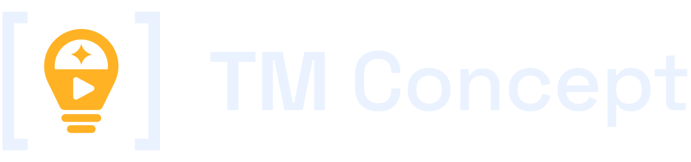

<p align="center"></p>

[English](README.md) · **Türkçe**

TM Concept, bir kanal fikrini video konseptlerine ve kısa videolara dönüştüren ücretsiz, açık kaynak (MIT) bir masaüstü programıdır.
Konseptleri **online yapay zekâ modelleri ve kendi API anahtarlarınla** yazar, video kodunu modele yazdırır, videoyu **kendi
bilgisayarında** render eder (ekran kartı gerekmez) ve **ücretsiz yerel bir sesle** seslendirir. Windows ve Linux'ta çalışır,
veritabanını şifreli tutar.

- [Ne yapar](#ne-yapar)
- [Ne kadar tutar](#ne-kadar-tutar)
- [Windows'a kurulum](#windowsa-kurulum)
- [Linux'a kurulum (x64 ve arm64)](#linuxa-kurulum-x64-ve-arm64)
- [İlk açılış](#ilk-açılış)
- [Modeller ve kurdukları](#modeller-ve-kurdukları)
- [API anahtarları](#api-anahtarları)
- [İlk videonu üret](#ilk-videonu-üret)
- [Güncelleme](#güncelleme)
- [Kaldırma](#kaldırma)
- [Verin nerede](#verin-nerede)
- [Bilmen gereken lisanslar](#bilmen-gereken-lisanslar)
- [Bilinen kısıtlar](#bilinen-kısıtlar)
- [Kaynaktan derleme](#kaynaktan-derleme)

## Ne yapar

- **Profil = kanal.** Kanal adı, video dili (Türkçe, İngilizce, Almanca, İspanyolca, Fransızca, İtalyanca, Portekizce, Felemenkçe,
  Lehçe, Rusça, İsveççe ya da Endonezce; notların kendi dilinde kalabilir, video bu dilde yazılır), dikey kısa ya da yatay video, hedef süre (15–180 sn), kanalın
  konsepti, isteğe bağlı kanal fotoğrafı (kapanış bitiş kartı için yuvarlak avatar) ve genel ayardan farklı
  olmasını istediğin her adım için kendi modelleri (ses, görseller, motor…). Fotoğraf profil daha yeniyken de eklenir; kaydedince
  kopyalanır. Dört hazır profil şablonu alanları doldurur (tarih: Bizans, Osmanlı; teknoloji: antik, modern).
- **Video şablonları** (Ayarlar → **Şablonlar**, en çok 20, profile bağlı değil): videoların nasıl görüneceği ve nasıl biteceği. Altyazı
  açık ya da kapalı, programın çizdiği ilerleme çubuğu (varsayılan kapalı), Türkçe harfleri olan altı ücretsiz yazı tipinden biri, başlık
  biçimi ve 3×3 ızgarada yeri, renk paleti, görseli olmayan sahnelerin çizim tarzı, hareket miktarı ve kapanış çağrısı ("Diğer videolar
  için abone olmayı unutma!"; YouTube'da *abone ol*, Instagram ve TikTok'ta *takip et*) seste, ekranda, ikisinde ya da kapalı; her zaman
  videonun dilinde. Form canlı önizleme gösterir. Her video başlarken şablonunun bir kopyasını alır; şablonu düzenlemek ya da silmek
  yapılmış videoyu değiştirmez.
- **Konsept üret.** Dört ayrı bölüm, istediğin sırayla kullanılır; hepsi aynı listeye ekler. **Konu önererek üret**: 5–100 konu önert, beğendiklerini işaretle, **Seçilenleri üret**'e bas: her
  işaretli konudan tam bir konsept. İşaretlemediğin konu kötü sayılmaz: sonra yeniden önerilebilir; yalnız konsepti yapılan konu bir daha
  gelmez (0.1.18'den önce önerilen konular engelli kalır: o sürüm hangisinden konsept yapıldığını kaydetmiyordu). **Fikirden üret**: bir fikir yaz (ya da boş bırak), 1–100 konsept seç. Her basış listeye ekler. Her
  konsept sahneleriyle gelir (hedef sürenin yaklaşık 13,5 saniyesinde bir sahne); sahnesi eksik konsept bir otomatik onarım alır, yine
  eksikse işaretlenir ve onaylarken sorulur. Her düğmenin yanında küçük bir tahmini ücret görünür; sonra sağlayıcının bildirdiği kullanımdan kesin ücret gelir. Tekrar dört katmanda
  önlenir: istemde bütün konseptlerin geçmişi (önbellekli), ücretsiz yerel benzerlik denetimi, gömme modeliyle isteğe bağlı anlamsal
  denetim ve liste büyüyünce sıkıştırılmış geçmiş. Her satırda **Onayla** (A tuşu) ve **Sil** (D tuşu) var; tıklanan konsept listenin
  yanındaki detay panelinde açılır. Silinenler **Silinenler** sayfasında süresiz durur (tekrar denetiminde sayılmaya devam eder); oradan
  kalıcı silinebilir.
- **Belgelerden** (üçüncü bölüm, 0.1.21). **Belgelerim** profilin kendi kaynaklarını tutar: PDF, Word (.docx), metin ve Markdown dosyaları,
  bir web sayfası (okunabilir metni, bir kez çekilir; hiçbir betik çalışmaz) ya da herhangi bir dilde bir Vikipedi makalesi (adresiyle ya da
  başlığı ve dil koduyla; yalnız açık internetteki adresler: bu bilgisayardaki ya da yerel ağdaki bir adres, yönlendirmeyle gelse bile
  alınmaz, bir sayfanın toplam 30 saniyesi var). Uygulama her birinin kendi kopyasını veri klasöründe tutar (şifresiz); parçalara bölünmüş
  metni şifreli veritabanındadır. Belgeler eklendikleri profile aittir; bir profil silinince kopyaları da silinir. İstersen bir konu yaz ve kaç tane istediğini seç: **Belgelerden yaz** o kadar
  konsepti bir seferde yazar, ya da **Konu bul** önce belgelerde o kadar konu arar, düğme sonra işaretli her konuya bir konsept yazar.
  Her çağrıya yalnız modelin bağlamına sığan parçalar gider (8k bağlamlı küçük bir yerel model yaklaşık 3–4 bin token parça, daha düşük
  bir yanıt sınırı ve o da yetmezse çağrı başına daha az konsept alır; ücretli bir model çağrı başına en çok 12 bin token, büyük bağlam
  pahalıya patlamasın diye). Başka yazıdaki parçalar (Japonca, Rusça, Yunanca…) başlıkları ve adlarıyla birlikte cömert sayılır. Uzun
  bir üretim ve konusuz her yeni basış aynı parçaları değil belgelerin başka yerlerini okur; bulunan bir konu, geldiği belgelerde kendi
  dilindeki arama kelimeleriyle aranır. İstem modele yalnız
  belgelerdeki bilgileri kullanmasını ve kullandığı belgeleri söylemesini ister (detay panelinde *Kaynaklar* olarak görünür); belgeler
  başka dilde olsa da konseptler videonun dilinde yazılır. Parçalar kelimelerine (BM25; ekli bir kelime kökünü de bulur, "Osmanlıların"
  "Osmanlı"yı bulur) ve isteğe bağlı anlam aramasını kurarsan
  (multilingual-e5-small, yaklaşık 135 MB, yalnız onaylarsan indirilir, bu bilgisayarın işlemcisinde çalışır) anlamlarına göre seçilir.
  **Taranmış sayfalar** kendiliğinden okunur: kullanılabilir metin katmanı olmayan bir sayfa (tarama, şekil olarak çizilmiş yazı ya da
  bozuk karakterlerden oluşan bir katman) PDFium ile bütün olarak çizilir (0.1.27, yaklaşık 4 MB, isteğe bağlı, taranmış sayfalar ilk kez okunurken sorulur;
  JPEG 2000, JBIG2 ve CCITT faks taramalarını ve döndürülmüş sayfaları da okur) ve *Taranmış sayfalardan yazı* motoru okur: yerel OCR
  (PaddleOCR PP-OCRv5, ücretsiz, bu bilgisayarda; motor seçilmemişse bu kullanılır) ya da bir görsel modeli. Windows'ta yerel OCR ekran
  kartı boştaysa ekran kartında okur (DirectML, her marka kart; Microsoft'un DirectML lisansındaki isteğe bağlı ~15 MB'lık indirme, bir
  kez sorulur; bir sayfa kart için en fazla iki saniye bekler, yani video ya da yerel bir model kartı elinde tutar), değilse işlemcide;
  Ayarlar → Genel → *Yazı tanıma* ile hep işlemcide kalabilir. Bir kez okunan sayfalar belgeyle saklanır ve bir daha okunmaz;
  **Belgelerden yaz** ve **Konu bul** önce seçili belgelerin hâlâ eksik olan sayfalarını okur. Ayarlar → **Depolama** her belgeyi listeler;
  ne **Kullanılmayanları temizle** ne **Kapsamlı silme** birini alır; satırını işaretlemek ya da bir belgenin **Sil**'i
  kopyasını ve parçalarını kalıcı olarak siler (bir belge eklenirken hiçbir şey silinmez). Yedekler belgeleri profillerle birlikte taşır (kayıtlar, parçalar ve
  kopyalar; kopyalar yedek başına en çok 256 MB, küçükten büyüğe: sınırı aşanlar alınmaz, günlüğe yazılır, kayıtları ve parçaları yine
  yedektedir).
- **Araştırmadan** (dördüncü bölüm, 0.1.22). Uygulama konuyu kendisi araştırır; hiçbir model kendi başına internette arama yapmaz, yani
  gizli bir arama ücreti yoktur. **Ara**; Vikipedi'ye (her dilde) ve Wikidata'ya (bilgiler: tarihler, yerler, kişiler) sorar, ikisi de
  ücretsiz ve anahtarsızdır; ayrıca *Seçenekler*'e yazdığın adreslere ve **Ayarlar → Araştırma**'da kurduysan kendi anahtarınla Tavily'ye
  ya da kendi MCP sunucularına. Profilin dilini, İngilizceyi ve en çok iki dil daha okur: senin eklediklerini ve konunun işaret ettiklerini
  (Bizans için Yunanca, Safeviler için Farsça, Osmanlı için Türkçe; toplam en çok dört). Yalnızca profilin dilinde ve İngilizcede arama
  yapılır; diğer dillere bulunan makalelerin dil bağlantılarıyla ulaşılır, yani aynı konu kendi Yunanca makalesinden okunur. Bir konunun
  birçok dildeki sürümü tek kaynak grubudur (Wikidata öğesiyle). **Ara** yalnızca alacağı sayfaları listeler ve plana göre işaretler (önce
  senin adreslerin, kalanın yaklaşık üçte biri diğer dillerden; *Sayfa* bir ya da iki ise önce profilin dili ve İngilizce); hiçbir şey
  indirilmez, model çağrılmaz. Sonradan konuyu, adresleri ya da dilleri değiştirirsen düğme yeniden arama ister; *Sayfa*'dan fazla sayfa
  işaretlersen bazılarını kaldırmanı ya da sayıyı artırmanı ister. Düğme sonra işaretli sayfaları alır (toplam
  en çok 12 sayfa, 4 MB ve iki dakika; iptal edilebilir; her adım etkinlik panelinde), bunu **Belgelerim**'deki korumalı alma ile yapar,
  sayfaları oraya kaydeder (parçalar, anlam araması) ve konseptleri yalnız onlardan, videonun dilinde yazar; her konsept kullandığı
  sayfaları söyler (*Kaynaklar*). Alınan bir sayfadaki yazı veridir: yazıyı gizleyen ya da sırasını değiştiren görünmez karakterler
  silinir (her belgeden, PDF'lerden de) ve sayfa istemin veri bloğunun içinde durur, yani modele talimat veremez. Tavily'nin ya da bir MCP
  sunucusunun bulduğu sayfa yalnızca sitenin robots.txt'si izin veriyorsa alınır; senin yazdığın adres istediğin gibi alınır. Alma işi
  ücretsiz servisleri yormaz: her siteye aynı anda tek istek gider, "biraz bekle" cevabına bir kez uyulur ve her istek uygulamanın adını
  ve proje sayfasını söyler (Wikimedia böyle istiyor), senin hakkında hiçbir şey söylemez. Bir çalışmanın eklediği sayfaların sonradan
  silinmesi için **Belgelerim'de tut** işaretini kaldır; çalışma iptal edilse ya da yarıda kalsa da öyle olur. Model
  çevrimiçi ya da yerel olabilir: parçalar her belgede olduğu gibi modelin bağlamına sığdırılır.
- **Konseptten video.** Solda onaylı konseptler (tıklanan, listenin altında açılır; orada elle ya da yapay zekâyla düzenlenir), **Sıraya
  ekle**, sonra **Sırayla üret**. Modeller (motoruyla kod, görseller, ses) üstte tek bir katlanmış satırdır, yanında **şablon** seçici
  (yeni kurulumda boştur: kod modeli ve şablon seçilmeden video üretilmez). Video üretilirken her aşama
  süresi ve ücretiyle, kod modelinin jetonları ve o ana kadar harcanan görünür. Üretilen videolar sağda: önizleme oynatıcısı,
  **Oynatıcıda aç**, **Klasörü aç** ve **Konsepti düzelt, yeniden üret**. Model tek bir kod dosyası yazar; hiçbir şey çalıştırılmadan
  önce güvenlik denetimi yapılır (sahne görselleri varsa kod onları göstermek zorunda); denetim ya da render hatasında tek onarım istenir
  (yerel kod modelinde onun yerine programın kendi animasyonu kullanılır). Render'dan sonra her sahneden bir kare denetlenir: yerel modelin
  boş kare ya da görselini göstermeyen videosu programın kendi animasyonuyla yeniden render edilir; online modelin videosu yalnız sahnelerin
  çoğu geçemezse durur (ücretli onarım yok), yoksa uyarıyla saklanır. Videolar en çok 3 dakikadır.
  **Bir video hata verirse sıranın tamamı durur** (hata sayfada, bildirimde ve etkinlik panelinde kırmızı görünür; sorunu düzeltince sırayı
  yeniden başlatırsın). **Gece modu** (**Sırayla üret**'in yanındaki kutu; her açılışta kapalıdır, sıra çalışırken de işaretlenebilir)
  bilgisayarın başında olmadığın zamanlar için: hata veren video bildirilir ve sıradaki videoya geçilir, videolar arasında 10 saniye
  beklenir, bellek yetmezse soru sorulmaz, o video hata sayılır; üst üste 3 videoda hata olursa sıra tamamen durur (boşuna ücret harcanmasın).
- **Sürümler.** Her sahnenin seslendirme metnini düzenle (yeni cümleler; duraklama, hız ve geçiş yer tutucuları) ve bir ses seç: ses bilgisayarında yeniden
  üretilir, aynı video kodu yeniden render edilir — yapay zekâ masrafı yok (online ses ücretli). Ya da başka bir motor için yeni kod yazdır
  (tahmin önce gösterilir ve onaylatılır); görseller, ses klipleri ve metinler yeniden kullanılır. Her yeni sürüm ayrı bir klasör (v2, v3…);
  eskiler kalır.
- **Üretilen videolar.** Küçük resim, program içi oynatıcı (oynat/duraklat, sarma çubuğu, süre, ses düzeyi, tam ekran; kendiliğinden
  başlamaz), ayrıntılar (motor, modeller, adım adım ücret, ses notları, konsept metni), sistem oynatıcısında aç, yeniden üret, klasörü aç, sürümü sil
  (dosyalarıyla birlikte, kalıcı olarak; onay boyutu gösterir).
- **Videolarını oyla.** Önizlemenin altında **👍 Beğendim** / **👎 Beğenmedim** (Üretilen videolar ve Konseptten video); aynı düğmeye
  tekrar basınca oy kalkar. Bir oy videonun bütün sürümleri için geçer. Sonraki konu ve konsept önerileri beğenmediğin videonun konusundan
  ve yakın konulardan uzak durur, beğendiğini örnek alır (benzer ruhta, farklı konular). Video yapmak beğenmek sayılmaz; oylanmamış video
  yalnız işlenmiş sayılır. Konsept ya da video silinse de oy kalır.
- **Bu ayın harcaması** sol üstte durur; ücretli bir iş sürerken o an harcananı da gösterir.
- **Bildirimler** sağ altta (konseptler hazır, video hazır, hata). Varsayılan 1 dakika; Ayarlar'dan süresi değişir ya da kapatılır.
  Bildirim hatayı ve harcananı da söyler; yapılan her şey eksiksiz olarak günlük dosyasına yazılır.
- **Şifreli.** Veritabanı (API anahtarların dahil) SQLite3 Multiple Ciphers ile şifrelidir. Anahtarı Windows (DPAPI), Linux anahtarlığı ya
  da bir ana parola korur. Günlük yedekler (son 10) parolalı dosyalardır (Argon2id + AES-256-GCM); içine neyin gireceğini sen seçersin
  (API anahtarları yalnız işaretlersen).
- **İki arayüz dili:** Türkçe ve İngilizce.

Başka kanalları **okumaz**, referans video kullanmaz. Videoları **kendi sesinle** seslendirebilir (İngilizce için Pocket TTS, Türkçe ve
dokuz dil daha için Chatterbox Multilingual V3; eklediğin kısa bir kayıttan; kimin sesini kopyaladığın senin sorumluluğunda).

## Ne kadar tutar

Program ücretsizdir. Yapay zekâ sağlayıcılarına yalnız kullandığın kadar doğrudan ödersin; program önce tahmini, sonra kesin ücreti
gösterir. Kabaca (5 Kas 2026 fiyatları; güncelleri sayfalarda her tahminin yanında, kendiliğinden güncellenir):

| Ne | Yaklaşık ücret |
|---|---|
| Claude Sonnet 5.5 ile 20 konsept | 0,15–0,25 $ |
| Claude Sonnet 5.5 ile 60–90 sn'lik bir videonun kodu | 0,10 $ |
| Yerel bir sesle seslendirme (Supertonic 3 ya da İngilizce için Kokoro) | ücretsiz |
| Yerel modelle anlamca tekrar denetimi | ücretsiz |
| Video başına 8 YZ görseli (fal FLUX 2 Flash) | 0,08 $ |
| Yerel modelle 8 görsel (FLUX.2 klein, FLUX.3 Image Klein, Z-Image Turbo, Qwen-Image…; kendi ekran kartın) | ücretsiz |

## Windows'a kurulum

Windows 10 ya da 11, 64 bit. Özellikleri aynı iki tür var. İkisi de aynı veri klasörünü kullanır: birinin kurduğu
modeller ve ayarlar ötekinde de vardır, aynı anda tek kopya çalışır.

| [Son sürümden](../../releases/latest) indir | Tür |
|---|---|
| `TMConcept-win-x64-Setup.exe` | **Kurulu (önerilir):** Başlat menüsü ve masaüstü kısayolu, Windows'un *Uygulamalar* listesinde görünür, güncellemede yalnız değişen kısım iner. |
| `TMConcept-Portable-win-x64.exe` | **Taşınabilir:** tek program dosyası, hiçbir şey kurulmaz; güncellenince kendini yeniler. |

Sürümdeki `.nupkg` ve `releases.win-x64.json` dosyaları kurulu türün güncellemeleri içindir; onları sen indirmezsin.

**Kurulu tür**

1. `TMConcept-win-x64-Setup.exe` dosyasını indir. İsteğe bağlı ama önerilir: sürüm notlarındaki SHA-256 değeriyle karşılaştır. PowerShell'de:
   ```powershell
   Get-FileHash .\TMConcept-win-x64-Setup.exe -Algorithm SHA256
   ```
2. Çift tıkla. Kurulum dosyası kod imzalı olmadığı için Windows **"Windows bilgisayarınızı korudu"** (SmartScreen) der: **Ek bilgi**'ye,
   sonra **Yine de çalıştır**'a tıkla. Yalnız senin kullanıcın için (yönetici yetkisi olmadan) `%LOCALAPPDATA%\TMConcept` altına kurar,
   kısayolları ekler ve TM Concept'i açar.
3. [İlk açılış](#ilk-açılış) ile devam et.

**Taşınabilir tür**

1. `TMConcept-Portable-win-x64.exe` dosyasını indir, SHA-256'sını aynı şekilde denetle.
2. Dosyayı kalacağı yere koy, örneğin `%LOCALAPPDATA%\Programs\TM Concept\TMConcept-Portable-win-x64.exe`, ve çift tıkla (SmartScreen
   yukarıdaki gibi; Windows genelde yalnız ilk seferde sorar).
3. Sonra kurulu türe geçmek için: Ayarlar → Genel → **TM Concept'i kur** aynı sürümün kurulum dosyasını indirir, sürüm notlarındaki
   SHA-256 ile karşılaştırır, çalıştırır ve taşınabilir kopyayı kapatır (dosya olduğu yerde kalır, istersen sil). Kurulu bir TM Concept'in
   üstüne aynı ya da daha eski bir kurulum hiç çalıştırmaz.

İki türde de yönetici yetkisi gerekmez; sisteme bir şey kurulmaz, sistem PATH'i değişmez. Ayarlar → Genel → *Sürüm türü* hangisinin
çalıştığını, sürümünü ve (kuruluysa) klasörünü gösterir.

**OneDrive notu:** videolar `Belgeler\TM Concept` altına kaydedilir. OneDrive Belgeler klasörünü yedekliyorsa her video buluta da
yüklenir. İstemiyorsan klasörü OneDrive ayarlarından hariç tut.

## Linux'a kurulum (x64 ve arm64)

Sıradan bilgisayarlarda `linux-x64`, 64 bit ARM bilgisayarlarda (ör. 64 bit masaüstlü Raspberry Pi 4 ya da 5) `linux-arm64` kullan.
Masaüstü oturumu gerekir.

1. [Son sürümden](../../releases/latest) `tm-concept-portable-linux-x64.tar.gz` (ya da `tm-concept-portable-linux-arm64.tar.gz`) indir.
2. İsteğe bağlı: SHA-256 değerini denetle: `sha256sum tm-concept-portable-linux-x64.tar.gz`
3. Kalacağı yere aç:
   ```sh
   mkdir -p ~/.local/opt
   tar -xzf tm-concept-portable-linux-x64.tar.gz -C ~/.local/opt
   ~/.local/opt/tm-concept/install-desktop-entry.sh   # isteğe bağlı: TM Concept'i uygulama menüsüne ekler
   ```
4. **Anahtarlık (önerilir).** Veritabanının kendiliğinden açılması için anahtar `secret-tool` ile masaüstü anahtarlığına konur:
   Debian / Ubuntu / Raspberry Pi OS: `sudo apt install libsecret-tools` · Fedora: `sudo dnf install libsecret` · Arch:
   `sudo pacman -S libsecret`. Anahtarlık yoksa program her açılışta ana parola sorar.
5. **Chrome kitaplıkları.** Video motorları başsız bir Chrome çalıştırır. Eksik kitaplık varsa Ayarlar → Genel (Kurulu bileşenler) tam
   `sudo apt install …` komutunu gösterir (program kök yetkisi kullanmaz). Tipik liste: `libnss3 libatk-bridge2.0-0 libcups2 libdrm2
   libxkbcommon0 libxcomposite1 libxdamage1 libxrandr2 libgbm1 libpango-1.0-0 libasound2`.
6. **ARM64:** Puppeteer'ın ARM64 Chrome'u yok. Remotion'u kur (kendi ARM64 tarayıcısını getirir) ya da sistem Chromium'unu kur
   (`sudo apt install chromium`); HyperFrames ve Revideo onu kullanır.
7. `~/.local/opt/tm-concept/tm-concept` ile (ya da menüden) başlat.

## İlk açılış

1. **Dil:** iki büyük düğme, Türkçe ve English (sistem dilin önde). Sonra Ayarlar'dan değişir.
2. **Yeni başla ya da yedekten yükle:** yalnız veri yokken görünür. *Yedekten yükle* bir `.tmcbak` dosyası ve parolasını ister, sonra
   dosyanın neler içerdiğini gösterir (profiller, konseptler, ayarlar, yedeklendiyse API anahtarları) ve geri yüklemeden önce sorar.
3. **Koruma ve yedek parolası:** veritabanı anahtarını Windows / anahtarlık ya da bir ana parola korur. **Yedek parolası** zorunludur
   (en az 12 karakter): günlük yedekler onunla şifrelenir. Bir yere yaz; parolasız yedek açılamaz.
4. **İlk profil:** bir şablon seç ya da kanalını doldur.

**Her sayfada yardım.** Özelliklerin, ayarların ve bölümlerin sağında küçük bir **?** var (Konseptler bölümleri ve seçenekleri, video
sırası ve şablonlar, her Ayarlar sayfası, bileşenler, depolama, araştırma ve MCP, günlük filtreleri, güncelleme ve kurulum pencereleri).
Üstüne gel ya da Tab ile ulaş: tek satırlık bir ipucu çıkar. Tıkla ya da Enter / Boşluk'a bas: ne işe yaradığını ve nasıl kullanılacağını
anlatan kısa bir açıklama açılır.

## Modeller ve kurdukları

Ayarlar'da model seçimi yok: her model onu kullanan sayfada seçilir ve son seçim **profil başına** saklanır (yeni profilde ücretli hiçbir
şey seçili değildir; "Önerilen" önerilenleri gösterir). **Konsept üret** sayfasında konsept modeli ve anlamca tekrar denetimi;
**Konseptten video**'da video kodu modeli ve motor, görseller ve seslendirme var. Her adım ne işe yaradığını
yazar:

- **Konsept üretimi** ve **Video kodu** — ücretini ödediğin online modeller. **Çaba** yalnız bunu alan modelde görünür; *Otomatik* çaba
  göndermez (sağlayıcının varsayılanı). **Video kodu**'nda **video motoru** da var: HyperFrames (varsayılan), Remotion (lisansını kabul
  etmeni ister: bireyler ve en çok 3 kişilik şirketler için ücretsiz), Revideo (deneysel). Görsel istemlerini de video kodu modeli yazar.
- **Görseller** — *Kapalı* (varsayılan: video yalnız koddan çizilir), bir online görsel modeli ya da ekran kartında çalışan 20 yerel
  modelden biri; her model bir ekran kartı bellek sınıfındadır (listede yazar; yeşil = kartın çalıştırır, kırmızı = "bu kart çalıştıramaz",
  böyle bir model hiç indirilmez):
  - **4 GB**: Z-Image Turbo (küçük), FLUX.2 klein 4B (en hızlı), SDXL Lightning
  - **6 GB**: Z-Image Turbo, FLUX.3 Image Klein, Stable Diffusion 3.5 Medium, SDXL Lightning (Q8), Qwen-Image 2.1 Turbo (**ticari kullanıma kapalı**)
  - **8 GB**: FLUX.2 klein 9B (**ticari kullanıma kapalı**)
  - **12 GB**: Z-Image Turbo (Q8), FLUX.2 klein 4B (Q8), Stable Diffusion 3.5 Medium (Q8), Qwen-Image 2.1 Turbo (Q8, **ticari kullanıma kapalı**)
  - **16 GB**: Qwen-Image (görsel içinde yazıda güçlü), FLUX.3 Image Klein (Q8), Qwen-Image 2.1 (**ticari kullanıma kapalı**)
  - **24 GB**: Z-Image Turbo (tam kalite), FLUX.2 klein 9B (Q8, **ticari kullanıma kapalı**), Qwen-Image (Q6)
  - **32 GB**: Qwen-Image (Q8)

  Bir model yalnız sen seçip onaylayınca indirilir. Lisanslar: çoğu Apache-2.0 (her kullanım serbest); **FLUX.2 klein 9B ve Qwen-Image 2.1
  (Qwen Research Lisansı) ticari kullanıma kapalı** (turuncu etiket: para kazandığın videolarda kullanılamaz; kırmızı yalnız "bu kart çalıştıramaz" demektir); FLUX.3 Image Klein (FLUX Kommunity Lisansı: Black Forest Labs'in
  duyurusuna göre yıllık geliri 5 milyon doların altındakiler için ticari kullanım ücretsiz), Stable Diffusion 3.5 Medium (Stability AI
  Topluluk Lisansı: 1 milyon doların altı) ve SDXL Lightning (OpenRAIL++ kullanım kısıtları) koşullu (sarı etiket). Bunların her biri ilk
  indirmeden önce bir kez lisansını kabul etmeni ister. Program her görselden önce kartın **boş** belleğini ölçer: VAE hep parça parça
  çalışır, belleğin yaklaşık sekizde biri (en az 1 GB) Windows ve öteki programlar için boş bırakılır. Seçtiğin model hiçbir zaman başka
  bir modelle değiştirilmez; yalnız ağırlıklarının nerede durduğu değişir: sığıyorsa kartta, sığmıyorsa ana bellekte (stable-diffusion.cpp
  kendisi yerleştirir, belleğe eşlenmiş olarak), ana bellek de yetmiyorsa diskten okunur. Kart dışındaki her yol daha yavaştır ve etkinlik
  panelinde sarı bir satırla söylenir (işlemci sürümüne geçiş de öyle); istersen iptal edip başka bir model seçersin. Belleği yetmeyen
  görsel her seferinde bir kademe aşağıda yeniden denenir. Her model ailesinin kart sınıfına göre kendi bellek rakamları vardır (örneğin
  Z-Image Turbo 6 GB'lık kartta daha az çalışma belleği ister). NVIDIA, AMD ve Intel kartlar
  çalışır: sürümü *Ayarlar → Genel → Görsel hızlandırma* seçer (Otomatik: sürücüsü kurulu NVIDIA kartta NVIDIA CUDA, AMD ve Intel kartlarda
  Vulkan, kart yoksa ya da yalnız sanal bir kart varsa işlemci; Linux x64'te Vulkan ya da işlemci). Windows'ta her sürüm Microsoft Visual
  C++ 2015–2022 çalışma zamanını (x64) ister; onu bulamayan video hiçbir şey ödenmeden durur ve indirme adresini söyler. Linux ARM64 için
  sürüm yok.
- **Seslendirme** — *Kapalı* (sessiz video, sarı uyarı), **Supertonic 3** (yerel, ücretsiz; bütün video dilleri; İngilizce
  dışındaki her dilin varsayılan sesi), **Kokoro 82M** (yerel, ücretsiz; İngilizcenin varsayılanı; yalnız İngilizce, Amerikan ve İngiliz sesleri; sözlüklü bir ses: bilmediği adları ve kelimeleri seste atlar, uyarı verir), **Ahenk Cep** (yerel, ücretsiz, yalnız
  Türkçe; tek sesin yedi okuma tarzı: düz, sakin, neşeli, şefkatli, hüzünlü, kızgın, şaşkın; 48 kHz, işlemcide çalışan 13 MB'lık bir
  model, bir dakikalık konuşma yaklaşık 10 saniye) ya da bir online ses. Yalnız profilin video dilini konuşan sesler listelenir; dil değişince yeni dili konuşmayan ses, adımda bir uyarıyla o
  dilin varsayılan sesine döner. Ses, hız ve ▶ Dinle (video dilinde kısa bir cümle) adımın içinde.
- **Online sesler (0.1.35):** OpenAI'ın yanında (konuşma modelleri 6 Ocak 2027'de kapanıyor): **Gemini 3.8 Flash TTS** ve **Flash Lite
  TTS** (Gemini API anahtarı; 30 ses, bütün video dilleri), **Google Cloud Chirp 3 HD** (Text-to-Speech API'si açık bir Google Cloud
  anahtarı) ve **ElevenLabs** v4, v4 Turbo, Flash v2.5 ve Multilingual v2. **yazgı-tts-1** (yerel, ücretsiz, Türkçe, sekiz ses, işlemcide;
  Apache-2.0) da seçilebilir, hiçbir zaman varsayılan değil.
- **ElevenLabs hesabındaki sesler (0.1.47):** ElevenLabs anahtarını kaydedince hesabındaki sesler (klon ve kütüphane sesleri dahil) arkada
  okunur ve sabit seslerin ardından sunulur; video dilini bilmediği belli olan ses listelenmez. Ses seçici son listeyi hemen gösterir,
  hesabı arkada yeniden okur; **↻ Sesleri yenile** hemen okur. Hesap okunamazsa sabit sesler kalır, işlem panelinde uyarı çıkar.
- **Chirp 3 HD için Google ile giriş (0.1.47):** Ayarlar → Anahtarlar → Google Cloud → **Google ile giriş**; kendi Google Cloud projendeki
  "Masaüstü uygulaması" türü bir OAuth istemcisiyle (adımlar programda, her adımda ilgili Google sayfasının düğmesiyle). Tarayıcı açılır,
  program jetonu 127.0.0.1 üzerindeki tek seferlik bir adresle (PKCE) kendisi alır, süresi dolunca yeniler ve faturalandırma için
  projenle birlikte gönderir. Yenileme jetonu şifreli veritabanında anahtarlarla aynı yerde durur. **Çıkış yap** onu siler ve Google'da
  iptal eder. İstemcin "Test" durumundayken Google girişi 7 günde düşer; "Üretimde" durumuna almak bunu önler. API anahtarı eskisi gibi
  çalışır; ikisi de varsa Google girişi kullanılır.
- **Ton yer tutucuları (0.1.35):** sahne metninde [heyecanlı], [sakin], [hüzünlü], [ciddi], [meraklı], [fısıltı], [gülerek], [iç çekerek]:
  Gemini ve ElevenLabs v3/v4 sesleri sonrasını o tonda okur (gülme ya da iç çekme bir kez, önünde); diğer sesler yok sayar; hiçbir zaman
  okunmaz ve altyazıda görünmez.
- **Kendi sesin** — **Pocket TTS** (yerel, ücretsiz, yalnız İngilizce): Ayarlar → Ses ve telaffuz → 3–15 saniyelik temiz bir kayıt ekle
  (WAV, MP3, M4A, OGG, FLAC; ffmpeg dönüştürür), sonra adımda ses olarak seç. Kayıt şifreli veritabanında kalır. Ağırlıklar CC-BY-4.0:
  yayınlarken "Pocket TTS, Kyutai (CC-BY-4.0)" atfını yaz. Hız ayarı yok.
  **Chatterbox Multilingual V3** (Resemble AI, MIT; yerel, ücretsiz) aynı kayıtlarla Türkçe, İngilizce, Almanca, İspanyolca, Fransızca,
  İtalyanca, Portekizce, Felemenkçe, Lehçe ve İsveççe konuşur. Yalnız işlemcide çalışır (ekran kartı kullanılmaz) ve yavaştır: 16 iş
  parçacıklı bir işlemcinin 8 iş parçacığıyla konuşmanın yaklaşık 6 katı, ilk sahnede ayrıca modelin yüklenmesi için yaklaşık 1,5
  dakika. Uzun sahneler cümle cümle (bir seferde en çok 300 karakter) okunur. Hız ayarı yok, filigran yok.
- **Python sesleri** (yerel, çalıştırması ücretsiz; indirmeleri büyük) — kendi Python'unda PyTorch ile çalışan sesler; uv bunları programın
  araç klasörüne kurar (sistemindeki Python'a, PATH'e ya da kayıt defterine bir şey yazılmaz): **XTTS-v2** (Coqui; video dillerinden 10'u,
  hazır konuşmacılar ya da kendi sesin), **F5-TTS Türkçe**, **VoxCPM2** (OpenBMB; bütün video dilleri, kendi sesin ya da tarifle
  oluşturulan bir anlatıcı), **Trendyol-TTS** (Türkçe), **Ahenk** (Türkçe, yedi duygu) ve **MMS-TTS Türkçe** (küçük, işlemcide). Sürücüsüyle
  birlikte bir NVIDIA kartın varsa CUDA ile kartta çalışırlar (adım, kartının yetip yetmediğini gösterir: XTTS-v2 ve F5 için 4 GB, VoxCPM2,
  Trendyol-TTS ve Ahenk için 8 GB); AMD ya da Intel kartta, ya da kart yoksa işlemcide çalışırlar ve adım bunun yavaş olduğunu söyler. İlk
  kullanımda Python 3.11, sesin PyTorch'lu paketleri (GTX 16 / RTX 20 serisinden itibaren, 570 ya da daha yeni sürücülü NVIDIA kartlar için yaklaşık 4 GB, diğerlerinde 1 GB'tan az: daha eski NVIDIA kartlar ve sürücüler sesleri işlemcide çalıştırır) ve model (0,15–5 GB)
  kurulur; onay penceresi her indirmeyi boyutuyla listeler. **XTTS-v2, F5-TTS Türkçe ve MMS-TTS Türkçe TİCARİ OLMAYAN lisanslıdır**: adım
  lisansı gösterir ve bir şey indirilmeden önce kabul etmeni ister; reklamlı, sponsorlu bir kanalda ya da ücretli işte kullanma. Ahenk
  (CC BY 4.0) yayınlarken anılmalıdır. Kartta konuşan bir Python sesi kartı diğer yerel modeller gibi tutar; seslendirme bitince boşaltılır,
  kart görseller için boş kalır.
- **Telaffuz** — Ayarlar → Ses ve telaffuz: her video dili için sesin farklı okuması gereken kelimeler (Türkçede "Viking" → "Vikink").
  Türkçe, kategorilere ayrılmış yüzlerce yabancı ad, marka, tarihî kişi, yer, kısaltma ve birimle gelir ("Google" → "Gugıl", "Machu
  Picchu" → "Maçu Piççu", "Churchill" → "Çörçil"); listede ara, bir kelimeyi düzenle (hazır bir kelime seninki olur), kendi kelimeni ekle
  ve kaydetmeden önce kurulu bir yerel sesle ▶ Dinle. Başına "!" koyduğun kelime yalnız yazıldığı gibi eşleşir ("!IT" yalnız "IT"yi
  değiştirir, "it" kalır). Kesme işaretinden sonraki ek okunuşa uyar ("Google'ın" → "Gugılın"). Türkçe seslendirme ayrıca her sesten
  önce, yerel ya da online, kurallarla okunur: sayılar, sıra sayıları ("3." → "üçüncü"), tarih ve saatler ("14.10.2026", "09:30'da"),
  yıllar, yüzdeler, para birimleri ("12,50 TL" → "on iki lira elli kuruş"), birimler ("120 km/sa" → "saatte yüz yirmi kilometre"),
  Romen rakamları ("II. Mehmed" → "İkinci Mehmed"), kısaltmalar ("Prof. Dr.", "vb.", "MÖ") ve büyük harfli kısaltmalar ("NATO" kelime
  gibi, "TBMM" harf harf). Yalnız ses değişir; altyazı yazıldığı gibi kalır.
- **Anlamca tekrar denetimi** — isteğe bağlı: yerel **Multilingual MiniLM** (ücretsiz, bu bilgisayarda, Türkçe dahil 50'den fazla dil) ya
  da bir online model.

**Üret**'e ya da **Kuyruğu üret**'e bastığında önce seçimler hazırlanır: henüz API anahtarı olmayan sağlayıcının adı söylenir ve anahtarı
oracıkta yapıştırabilirsin (ücretsiz bir istekle denenir, yalnız çalışırsa saklanır); sonra bir seçim bu bilgisayarda olmayan bir şey
gerektiriyorsa **tek bir onay bütün indirmeleri listeler** (ad, kaynak, boyut). Onaysız hiçbir şey indirilmez. Programın üstünde açılan
bir pencerede kurulur (her indirme bir satırda, ilerlemesiyle; program bu sırada bekler, İptal durdurur) ve
iş kendiliğinden devam eder. Onaylamazsan, vazgeçersen ya da kurulum başarısız olursa hiçbir şey
başlamaz, hiçbir şey ödenmez; sebebi görünür. Saklanan bir seçimin bileşeni sonradan kaldırıldıysa bir dahaki sefere yeniden kurulur.

**Seçimlerin yaptığın gibi kalır.** Model, efor, motor, ses ya da hızdaki her değişiklik o an profil için kaydedilir; sayfa değiştirmek,
programı yeniden açmak, yeni API anahtarı ya da yeni yerel sunucu eklemek eski bir seçimi geri getirmez. Seçtiğin model şu an
sunulmuyorsa (yerel sunucusu silindi ya da onu artık listelemiyor, ya da bu sürümde yok) seçili kalır ve sebebiyle birlikte *şu an
kullanılamıyor* diye görünür; geri gelene ya da başka bir model seçene kadar onunla hiçbir iş başlamaz.

**Ekran kartında aynı anda tek yerel model.** Bu bilgisayardaki bir yerel sunucunun modelleri (Ollama, LM Studio, llama-server,
Lemonade…) ve yerel görsel modelleri ekran kartını paylaşır: bir yerel model başlamadan önce ondan önce kullanılan boşaltılır (sunucusuna
sorulabiliyorsa) ve program kartın belleği yeniden boşalana kadar bekler; online modeller ve sherpa-onnx sesleri (işlemcide çalışırlar) hiç
beklemez; NVIDIA kartta konuşan bir Python sesi kartı görsel modelleri gibi alır. Bir model boşaltıldıktan sonra (bir videonun sonunda
kart boşaltıldığında da) program 3 saniye bekleyip boş belleği ölçer; yetmezse 2,5 saniye bekleyip yeniden ölçer; yine yetmezse bir
pencere kartın toplam ve boş belleğini, modelin ihtiyacını ve boş ana belleği gösterir: ekran kartını ya da belleği kullanan programları
(oyun, tarayıcı) kapatıp **Yeniden dene**'ye basarsın (5 saniye bekleyip yeniden ölçer, istediğin kadar; TM Concept'in kendi yerel
sunucusunda bellekten çıkarılamayan bir model varsa pencerede adıyla yazar ve her yeni ölçümden önce onu bir kez daha çıkarmayı dener), ya da **İptal**'e (video sırası
durur, program açık kalır). Her adım etkinlik panelinde bir satırdır. Gece modunda soru sorulmaz: o video hata sayılır. Boş bellek her seferinde ölçülür: Windows'ta Görev Yöneticisi'nin gösterdiğiyle Windows'un programa izin verdiğinden (ikincisi tek başına hiçbir görseli reddettirmez, yalnızca sd-cli'ye yükü ana belleğe aktarttırabilir) küçük
olanı, Linux'ta AMD sürücüsünün dosyaları ya da `nvidia-smi`. Ekran belleği sınıfları 4, 6, 8, 12, 16, 24 ve 32 GB'tır: bir kart
bildirdiği belleğe yüzde 8 payla en yakın sınıfta sayılır (15,8 GB bildiren "16 GB" kart 16 GB'lık, 11 GB'lık kart 8 GB'lık karttır), kendi sınıfını ve
altındakileri kullanabilir; daha yüksek sınıftaki model kırmızı görünür. Bu bilgisayardaki Ollama ya da LM Studio'nun önceden (önceki bir
çalıştırmadan; LM Studio yüklenen modeli süresiz tutar) tuttuğu modeller bir çalıştırmanın ilk yerel modelinden önce boşaltılır; son yerel
model de video kuyruğu bitince ve program kapanırken boşaltılır. Sunucusunun boşaltmadığı bir model bir sonraki değişimde yeniden istenir.

**JSON olması gereken cevaplar.** Konseptler, konu önerileri, yapay zekâ düzenlemesi ve görsel istemleri hoşgörüyle okunur (düşünme
blokları, kod çitleri ve cevabın etrafındaki metin atlanır, küçük hatalar onarılır). Yine de okunamayan cevap için aynı istek en çok
iki kez daha gönderilir; her deneme ödenir ve maliyete sayılır, üç okunamayan cevaptan sonra iş "cevap okunamadı" diye durur.
*Ayarlar → Genel → Konu önerileri* bir konu cevabının yazabileceği en fazla tokenı belirler (varsayılan 16 000; yalnız yazılana ödersin).

| Bileşen | Kaynak | Yaklaşık |
|---|---|---|
| Node.js 26.13.0 (yalnız PATH'te npm'li bir Node.js 22 ya da yenisi yoksa) | nodejs.org | 35 MB |
| ffmpeg 8.1.3 (GPL derlemesi, ayrı program; Linux'ta dağıtımın kopyası varsa o) | github.com (BtbN) | 130–200 MB |
| Motor paketleri + Chrome Headless Shell | registry.npmjs.org, storage.googleapis.com | 200–350 MB |
| Supertonic 3 + sherpa-onnx 2.0.1 | github.com (k2-fsa) | 140 MB |
| Kokoro 82M v1.0 int8 (sherpa-onnx gerekir) | github.com (k2-fsa) | 130 MB |
| Pocket TTS int8 (sherpa-onnx gerekir) | github.com (k2-fsa) | 98 MB |
| Chatterbox Multilingual V3 ONNX (Masterx dönüşümü, 4 bit dil modeli; sherpa-onnx gerekir) | huggingface.co | 1,56 GB |
| Ahenk Cep int8 ONNX (Türkçe; sherpa-onnx gerekir) | huggingface.co | 13 MB |
| Multilingual MiniLM (paraphrase-multilingual-MiniLM-L12-v2, int8 ONNX + tokenizer; sherpa-onnx gerekir) | huggingface.co | 127 MB |
| Multilingual E5 small (intfloat/multilingual-e5-small, int8 ONNX + tokenizer; belgelerin anlam araması, isteğe bağlı; uygulamanın içindeki ONNX Runtime ile çalışır) | huggingface.co | 135 MB |
| Yerel OCR: PaddleOCR PP-OCRv5 algılayıcı + Latin tanıyıcı (RapidOCR ONNX dosyaları; *Taranmış sayfalardan yazı*; uygulamanın içindeki ONNX Runtime ile çalışır) | www.modelscope.cn | 13 MB |
| PDFium 159.0.8138 (taranmış PDF sayfalarını OCR ya da görsel modeli için çizer; *Taranmış sayfalardan yazı* motoruyla birlikte kurulur) | github.com (bblanchon) | yaklaşık 4 MB |
| ONNX Runtime 1.24.4 DirectML derlemesi + DirectML 1.15.4 (yerel OCR ekran kartında; ekran kartlı Windows x64, isteğe bağlı, Microsoft'un DirectML lisansı) | api.nuget.org | yaklaşık 15 MB (diskte 36 MB) |
| stable-diffusion.cpp (Windows master-1106, Linux master-1043), Görsel hızlandırma'nın seçtiği derleme (Windows: CUDA 12 derlemesi + CUDA kitaplıkları, Vulkan ya da işlemci derlemesi; Linux x64: Vulkan ya da işlemci derlemesi) | github.com (leejet) | CUDA 975 MB, Vulkan 30–38 MB, işlemci 18–27 MB |
| Yerel görsel modeli ağırlıkları (difüzyon modeli, metin kodlayıcı(lar), VAE), yalnız seçtiğin model | huggingface.co | 2,9 GB (SDXL Lightning) ile 30 GB (Qwen-Image Q8) arası; ör. FLUX.2 klein 4B 5,3 GB, Z-Image Turbo 9,4 GB |
| uv 0.13.6 + Python 3.11.18 (Python sesleri için) | github.com (astral-sh) | 45 MB |
| Ollama (TM Concept) 0.40.16, programın kendi Ollama kopyası (Ayarlar → Yerel yapay zekâ; açıldıktan sonra yalnız kartının ihtiyaç duyduğu grafik parçası kalır) | github.com (ollama) | Windows'ta 1,6 GB indirme (diskte yaklaşık 0,2–1,3 GB kalır), Linux'ta 1,5–1,6 GB |
| Onun metin modelleri (Qwen 3.5, Gemma 4, gpt-oss; yalnız indirdiklerin) | registry.ollama.ai | 1,9 GB (Qwen 3.5 2B) ile 22 GB (Qwen 3.5 35B A3B) arası |
| PyTorch 2.8'li Python ses paketleri (her ses ailesi için bir takım: XTTS-v2, F5-TTS, VoxCPM2/Trendyol/Ahenk için VoxCPM2, MMS) | download.pytorch.org, pypi.org | NVIDIA (CUDA 12.8): her biri yaklaşık 3,7 GB (Linux 4,1 GB); işlemci: her biri 0,7–1 GB |
| XTTS-v2 / F5-TTS Türkçe / VoxCPM2 / Trendyol-TTS / Ahenk (+ VoxCPM2) / MMS-TTS Türkçe modelleri | huggingface.co | 1,9 GB / 1,4 GB / 5 GB / 5 GB / 145 MB / 145 MB |

Sabitlenen her indirme SHA-256 ile denetlenir (npm paketleri: kilit dosyasının bütünlük değerleri; görsel ağırlıkları sabit bir Hugging Face
commit'inden gelir; kopan bir görsel ağırlığı indirmesi aynı indirme içinde yeniden denenir ve kaldığı yerden sürer; sonraki kurulum ya da açılış yarım kalan dosyayı silip baştan indirir) ve programın kendi veri klasörüne gider; sistem PATH'i değişmez. Chrome Headless Shell HTTPS ile Google'dan gelir,
Google onun için sağlama değeri yayımlamıyor. Ayarlar → **Genel** → *Kurulu bileşenler* diskte olanları boyutlarıyla listeler (yarım kalan
ya da artık kullanılamayan *eksik* diye işaretlenir), kaldırabilir ve bir motorun örnek
videosunu modelsiz, ağsız render edebilir.

**Depolama.** Program küçük başlar ve yalnız seçimlerinin gerektirdiğini indirir; Ayarlar → **Depolama** neyin yer kapladığını gösterir:
programlar, modeller, iş önbellekleri, yedekler ve günlükler için toplamlar, ve her bileşenin boyutu, *kullanılıyor*, *kullanılmıyor* ya da
*yarım* olduğu, hangi profilin hangi adımda kullandığı (bütün profillerin kayıtlı model seçimlerinden). 10 GB'lık bir sesten 5 GB'lık birine
mi geçtin? Eskisi *kullanılmıyor* görünür. **Seçilenleri kaldır** işaretli satırları kaldırır, **Kullanılmayanları temizle** hiçbir profilin
kullanmadığı bileşenleri ve kendiliğinden yeniden oluşan artıkları (yarım indirmeler, eski bileşen sürümleri ve klasörleri, 7 günden eski
önbellekteki seslendirmeler ve iş klasörleri; yeni seslendirmeler ve sahne görselleri kalır, yeniden denemede yeniden ödemek yerine
kullanılır; HyperFrames ve Revideo'nun tarayıcısı bir profil onlarla video yaptıkça kullanılıyor sayılır) kaldırır; bu kopyanın
tanımadığı, daha yeni bir sürümün ya da model kataloğunun kurduğu bir görsel model klasörü ayrı satırda durur ve temizlik onu hiç almaz, **Kapsamlı silme** bütün araçları ve önbellekleri kaldırır. İki temizlik de hiçbir
modeli (sesler, görsel modelleri, anlam denetimi modeli, programın Ollama modelleri, yazı tanıma) ve belgeyi almaz: satırını işaretleyip
**Seçilenleri kaldır**'ı kullan. Her şey, boyutu gösteren bir onaydan sonra kalıcı olarak silinir (geri dönüşüm kutusu adımı yok: eski
bileşen klasörü gigabaytlarca tutar); silinemeyen bir satır (kullanımdaki bir dosya) nedeniyle bildirilir; video, üretim, seslendirme,
kurulum ya da bir motorun örnek videosu sürerken hiçbir şey kaldırılmaz. Veritabanın, profillerin, konseptlerin, videoların, yedeklerin ve
günlüklerin orada asla silinmez. Sayfa geride kalanı da bulur: video kütüphanesindeki **kaydı olmayan video klasörleri** ve **hiçbir
profilin kullanmadığı görseller** (yalnız programın kendi dosyaları; yalnız işaretlersen silinir), silinmiş konseptlerin sahne görselleri,
dinleme ve deneme çıktısı dosyaları.

**Silme.** Bir şeyi silmek, ondan doğan her şeyi, boyutu gösteren bir onaydan sonra kalıcı olarak siler: video sürüm klasörünü (son sürümle
birlikte konseptin klasörünü de) götürür; çöpten silinen konseptler videolarını ve sahne görsellerini götürür; profil videolarını, kanal
fotoğrafını, belge kopyalarını ve konseptlerinin sahne görsellerini götürür (başka bir profilin hâlâ kullandığı dosya kalır); silinen ses
örneği onunla önbelleğe alınan seslendirmeyi götürür. Önce dosyalar, sonra
kayıt gider: bir dosya kullanımdaysa kayıt kalır, nedeni gösterilir, tekrar deneyince iş biter. Yeni bir sürüm ya da video kuyruğu
çalışırken video ya da çöpteki konsept silinmez. Modellere, sen işaretlemedikçe hiçbir silme ya da temizlik dokunmaz. Eski iş dosyaları (7 günden eski önbellekteki seslendirme ve iş klasörleri) açılışta ve video kuyruğunun
sonunda temizlenir.

**Katalog bir model hakkında ne diyor.** Seçicideki her modelin kendi **?** işareti var; programın zaten bildiği bilgileri gösterir,
hiçbir yorum katmaz (açık listede ipucu olarak çıkar; seçicinin hemen sağındaki **?** seçili modelin notlarını açar): nerede çalıştığı ve
ücretsiz olup olmadığı (yerel modeller; eklediğin sunucunun ücret kaydı yok), fiyatı (sınırının üstündeki uzun bağlam fiyatı da), bir sesin dilleri (Türkçe var mı), lisansı (ticari kullanım serbest,
yalnız koşullarıyla ya da hiç), ekran kartı sınıfı ve bu kartta çalışıp çalışmadığı, model dosyalarının boyutu (ilk kurulum çalışma ortamını da indirebilir), bağlamı ve en uzun cevabı, görsel
okuyup okumadığı ya da düşünüp düşünmediği, bir sesin kendi ses örneklerinle konuşup konuşmadığı. Seçicinin yanındaki **?** işe yarar
bilgileri paylaşanları sayar, ör. "Türkçe, ticari kullanım ve bu bilgisayarda çalışır: …" (kart istemeyen ses de sayılır). Katalogda olmayan bir bilgi yazılmaz, tahmin edilmez.

Fiyatlar kendiliğinden, günde en çok bir kez güncellenir: program bu deponun `pricing/prices.json` dosyasını ve OpenRouter'ın herkese açık
model listesini okur (anahtar gönderilmez), denetler ve son iyi kopyayı saklar; internet yoksa yerleşik tablo kullanılır. Tahmin
kutuları tarihi ve kaynağı gösterir; Üretilen videolar sayfası bu ayın harcamasını gösterir.

Pencereyi varsayılan olarak işlemci çizer (görünüm aynı, yaklaşık 50–70 MB daha az bellek). Kaydırma ya da oynatıcı yavaş gelirse
Ayarlar → **Genel** → **Pencereyi ekran kartıyla çiz** seçeneğini aç ve programı yeniden başlat.

## API anahtarları

Ayarlar → **Anahtarlar**: sağlayıcıyı seç, anahtarı yapıştır, **Kaydet ve bağlantıyı dene**'ye bas (ücretsiz bir istek; fal'da ücretsiz
deneme yok). Anahtarlar şifreli veritabanında durur, yalnız kendi sağlayıcısına gider, günlüğe yazılmaz. Yedeğe yalnız Ayarlar → Yedek
altında *API anahtarları*'nı işaretlersen girer (yedek dosyası yedek parolanla şifrelidir). Anahtarı olmayan bir sağlayıcıya ihtiyaç duyan
sayfa, başlamadan önce anahtarı sorar. Her sağlayıcı
için adım adım rehber: [docs/api-keys.tr.md](docs/api-keys.tr.md).

**Özel sunucu:** OpenAI uyumlu her sunucu; bilgisayarında (AMD'de Lemonade Server, ROCm ya da Vulkan sürümleriyle llama.cpp
`llama-server`, Ollama, LM Studio, vLLM), ağında ya da internette, aynı yerden eklenebilir (**Özel sunucu (OpenAI uyumlu)**: herhangi
bir http/https adresi, isteğe bağlı API anahtarı, modelleri). Modelleri bundan sonra her metin adımında sunulur.
Bu bilgisayarda çalışan Ollama ve LM Studio kendiliğinden bulunur (**Bu bilgisayarda bulunanlar** → **Ekle**): program yüklü modellerini
listeler, her birini senin ayarladığın bağlamla yükler ve bir görsel ya da ses modeli ekran kartını isteyince karttan indirir; Ollama'da
deneme, bir modelin ne kadarının kartta, ne kadarının ana bellekte olduğunu gösterir.
Rehber: [docs/api-keys.tr.md](docs/api-keys.tr.md#özel-sunucu-openai-uyumlu), [Ollama ve LM Studio](docs/api-keys.tr.md#ollama-ve-lm-studio).

**Yerel yapay zekâ (programın kendi Ollama'sı).** Anahtarın da kendi sunucun da yok mu? Ayarlar → **Yerel yapay zekâ**, *Ollama (TM
Concept)*'i, yani Ollama'nın resmî sürümünün (0.40.16) programa ait kopyasını kurar ve ona metin modelleri indirir. Sen listeyi
onaylamadan hiçbir şey inmez (kurulum penceresi ilerlemeyi gösterir ve iptal edebilirsin; iptal edilen bir model indirmesinin inen kısmı
sonraki kurulumda silinir ve model yeniden indirilir). Açıldıktan sonra yalnız kartının ihtiyaç duyduğu grafik parçası kalır: NVIDIA için CUDA 12 ya da 13
(sürücüye göre), AMD ve Intel için Vulkan, işlemci için hiçbiri (sonradan yeni bir kart ya da sürücüyle başka bir grafik parçası
gerekirse program kurulu değil görünür ve yeniden kurulması önerilir; açma başarısız olursa doğrulanmış indirme bir sonraki deneme için
saklanır). Önerilen modeller (Qwen 3.5, Gemma 4, gpt-oss; hepsi Apache-2.0) ekran
kartı sınıfına göre (4, 6, 8, 12, 16, 24, 32 GB) boyutlarıyla listelenir: yeşil bağlamıyla birlikte kartına sığar, kırmızı sığmaz (bir
kısmı ana bellekte çalışır, çok daha yavaş), turuncu ise ticari kullanımı kısıtlayan bir lisansı gösterir. Sunucu yalnız bir model
kullanılınca başlar, yalnız 127.0.0.1'de kendine ait bir portta dinler (11534 ya da sıradaki boş port; asla 11434 değil), modellerini
programın veri klasöründe (`tools/ollama-models`) tutar, aynı anda tek model yükler, başka bir yerel model kartı isteyince onu indirir
(`keep_alive: 0`) ve TM Concept kapanınca kapanır. Kurulan modeller her metin adımında (konular, konseptler, video kodu, görsel
istemleri…) diğer modeller gibi ücretsiz ve anahtarsız sunulur. Ayarlar → **Depolama** programı ve her modeli boyutuyla, hangi profilin
kullandığıyla (eski bir sürümün önerdiği bir model de dahil), ayrıca hiçbir modelin kullanmadığı model dosyalarını (iptal edilen bir
indirmenin gelen kısmı; programın sunucusu bunu kendi silmez) listeler ve işaretlenince kaldırır (kalıcı olarak). **Sunucuyu durdur**, bir
adım, video, kurulum ya da indirme sunucuyu kullanıyor olabilirken reddedilir. Modelin bağlamından büyük bir istem gönderilmeden hata
verir ve daha büyük bir model seçmeni söyler. Kendi çalıştırdığın Ollama ya da LM Studio'ya hiç dokunulmaz: kullanmak
istersen özel sunucu olarak ekle.

Sonra modelleri onları kullanan sayfalarda seç (yukarıya bak). Ücretli hiçbir şey senin yerine seçilmez.

## Araştırma kaynakları (Ayarlar → Araştırma)

"Araştırmadan" varsayılan olarak Vikipedi'ye ve Wikidata'ya sorar (ücretsiz, anahtarsız). İki isteğe bağlı ek:

- **Tavily** (yapay zekâ uygulamaları için yapılmış, her ay ücretsiz kullanım hakkı veren bir web araması): tavily.com'da ücretsiz hesap
  aç, API anahtarını kopyala ve **Ayarlar → Araştırma**'ya yapıştır. Anahtar diğer anahtarların gibi şifreli saklanır, yalnızca Tavily'nin
  kendi adresine gönderilir ve günlüğe asla yazılmaz. Tavily'nin yalnızca sonuç listesi kullanılır; sayfaları uygulama kendisi alır.
- **Gelişmiş: MCP sunucularım** (varsayılan kapalı). Bir Streamable HTTP adresi ya da bu bilgisayardaki bir program ekle (Windows'ta
  programın tam adını yaz, ör. `npx.cmd`), **Bağlan ve araçları listele**'ye bas, arama aracını (isteğe bağlı olarak alma aracını) ve
  her birinin aldığı argümanı seç, kaydet. Bir sunucu ilk kez başlatılmadan ya da ona ulaşılmadan önce uygulama bir uyarı gösterir: MCP
  sunucusu başkasının programı ya da servisidir; senin yetkilerinle çalışır ve arama kelimelerini görür. Uygulama yalnızca seçtiğin iki
  aracı çağırır (sunucunun listelemediği bir araç reddedilir), cevaplarına her web sayfası gibi davranır ve bir programı uygulamanın
  ortam değişkenleri olmadan başlatır, yani ortam değişkenlerindeki anahtarlar ona ulaşmaz. Sunucu programı uygulamaya bağlanır ve
  onunla biter; arama sürerken uygulamayı kapatsan da açık kalmaz. Arama cevabındaki bu bilgisayara ya da yerel ağa ait bir adres
  hiçbir zaman önerilmez ve alma aracına gönderilmez. Yanlış biçimde cevap veren bir sunucu yalnızca kendi satırını bozar; diğer
  kaynaklar devam eder. DeepWiki ve Context7 kod belgeler, tarih değil: burada işe yaramazlar.

## İlk videonu üret

1. **Konseptler:** modelleri seç (istersen ton, izleyici ve anlatım biçimi ince ayarını da). Ya **Konu öner**'e basıp beğendiklerini
   işaretle ve **Seçilenleri üret**'e bas, ya da bir fikir yazıp **Üret**'e bas, ya da kaynaklarını **Belgelerim**'e ekleyip **Belgelerden
   yaz**'a bas, ya da **Araştırmadan**'a bir konu yazıp **Ara**'ya bas, bulduğu sayfalara bak ve altındaki düğmeye bas.
2. Bir konsepte tıkla, detay panelinde oku; iyileri onayla (A), kalanı sil (D). **Düzenle** (ya da **Yapay zekâyla düzenle**) metni
   değiştirir; `[duraklama 1 sn]`, `[yumuşak geçiş]` gibi yer tutucular imlecin olduğu yere eklenir, program videoda kendisi uygular.
3. **Konseptten video:** onaylı konseptlerde **Sıraya ekle**'ye bas, üstteki modellere bak, **Sırayla üret**'e bas.
   Önce modellerin yanından bir **şablon** seç (Ayarlar → Şablonlar'da oluşturursun). Altyazısı kapalı bir şablonda ne altyazı ne de ekranda
   anlatım yazısı olur (video koduna çizebileceği anlatım verilmez). Seçim bu bilgisayarda saklanır ve sıradaki her video başlarken okunur:
   değişiklik bir sonraki videoya uygulanır, yapılmakta olana değil.
4. **Üretilen Videolar:** program içinde izle (Linux'ta ses PulseAudio ya da PipeWire ile), klasörü aç. Her video, konseptin klasöründe bir sürüm klasörüdür (`v1/`): `video.mp4`, `subtitles.srt`, `narration.txt` (her zaman yazılır) ve `thumbnail.jpg`; ayrıca sonraki bir yeniden render için `source/` (render edildiği hâliyle motor projesi: modelin kodu, `input.json`, sahne görselleri) ve `audio/` (her sahnenin seslendirme klibi).

**Kanaldan profil (0.1.53, isteğe bağlı):** profil sayfasında **Kanaldan esinlen…** bir kanalın adresini alır ve kanalın herkese açık
bilgilerinden (başlıklar, süreler, açıklamalar; yt-dlp ile çerezsiz ve girişsiz okunur) ve birkaç örnek videosunun temposundan (düşük
çözünürlükte iner, ölçülür ve hemen silinir) yeni bir profil taslağı hazırlar. Metin modeli seçiliyse tek bir çağrı kanalın üslubunu,
metinlerini kopyalamadan tarif eder; ölçülen tempoyla yeni bir şablon da önerilir. Taslağı düzenleyip oluşturursun; mevcut profiller ve
şablonlar değişmez, kanalın kimin olduğu doğrulanmaz.

### Şablon videoda nasıl görünür

Bir şablonla (Ayarlar → Şablonlar) üretilen video, modelin iyi niyetine kalmadan ona uyar:

- **Modelin değil, programın çizdikleri:** altyazı (şablonun yazı tipi ve renkleriyle), üst kenardaki ince ilerleme çubuğu (yalnız
  şablonda açıksa) ve kapanış kartı video birleştirilirken programca eklenir. Video kodundan bunları çizmesi istenmez; kendisi ilerleme
  çubuğu, sayaç ya da sahne numarası çizen, altyazısız bir videoda anlatımı okuyan ya da başka bir yazı tipi adı yazan kod tek onarımına
  geri gönderilir (varsa güvenlik bulgularıyla birlikte; onarım bütün sorunları bir kerede duyar). Onarılan kod şablonu yine bozarsa
  video üretilmez ve hata sırada görünür (gece modu bunu hata sayar).
- **Renkler ve yazı tipi:** kod şablonun paletini ve yazı tipini alır (programla gelen, Türkçenin bütün harflerini çizen altı SIL OFL yazı
  tipi). Paletin dışındaki bir renk, ücretli bir onarım olmadan bu bilgisayarda paletin en yakın rengiyle değiştirilir.
- **Kapanış:** seçtiğin cümle videonun dilindedir ve platformun söylediği gibidir (YouTube: abone ol; Instagram ve TikTok: takip et).
  *Seste*: cümle, seslendirilmeden önce son sahnenin anlatımının sonuna eklenir; böylece altyazıda ve `narration.txt`'de de olur.
  *Ekranda*: videonun sonuna birkaç sessiz saniye eklenir ve orada profilin kanal fotoğrafı (profilde varsa, yuvarlak), kanal adı, cümle
  ve bir düğmeyle bir kapanış kartı çıkar; kart son sahneyi ya da anlatımını hiç örtmez. Seslendirme kapalıysa sesli kapanış kartta gösterilir.
- **Programın çizdiği videolar (0.1.33):** yeni şablonun HyperFrames videolarını programın kendi katman kütüphanesi çizer. Video kodu
  modeli yalnız her sahnenin planını yazar — resmi, gerçek sınırlardan çizilen bir harita (Natural Earth), etiketli kutulardan bir şema ya
  da bir başlık ve anlatımın her cümlesine bir adım: çizilerek ilerleyen yollar, oklar, iğneler ve etiketler, vurgular, sayan sayılar,
  yerler arasında gezen kamera, yolu yürüyen figürler — program bunu çizer ve sesle zamanlar. *Hareketsiz / Normal / Hareketli* ne kadar
  hareket olacağını belirler. İsteğe bağlı bir görsel modeli (yerel Gemma 3 4B ya da ucuz bir çevrimiçi model) üretilen resimlerde
  şeylerin yerini bulur, işaretler tam üstüne gelir. *Serbest kod* (animasyonu model yazar) şablonda seçenek olarak duruyor.
- **Son işlem (0.1.43, yeni şablonlarda açık):** programın çizdiği sahnelerin üstüne çizim tarzına uygun bir katman: kâğıt dokusu, gren,
  köşe gölgesi, yumuşak ışıma, derinliğe göre gölge ve saniyede 12 adımlık hafif titreme, hepsi sabit bir tohumdan. Her tarz bilinen
  tuzaklarını da sahne planı isteğine yazar. Yapay zekâya ek istek yok.
- **Arka plan müziği (0.1.44, varsayılan kapalı):** *Kendi dosyam* videonun tamamının altına kendi parçanı koyar. Anlatım konuşurken
  kısılır, sahne aralarında yükselir (cümleler arasındaki kısa nefeslerde yükselmez); kısa parça döner, uzun parça kesilir, sonda kararır.
  Düzey, kısma miktarı ve kararma müzikle birlikte ayarlanır (0.1.54: Konseptten video sayfasında modellerin altında, profil başına;
  artık şablonda değil). Dosya her videonun sürüm klasörüne (`music/`) kopyalanır, yeni sürüm aynı parçayı
  kullanır. Lisansı senin sorumluluğunda; isteğe bağlı atıf, video bitince video sayfasında açıklamaya kopyalanmak üzere gösterilir
  (videoya yazılmaz). Her sürüm klasöründe videonun kullandığı dış dosyaları listeleyen bir `assets.json` var.
- **Müzik üretimi (0.1.46):** *Üret (yerel)* müziği rakkase üzerinden ACE-Step 1.5 ile üretir (MIT; NVIDIA kartlar için, 16 GB RAM,
  yaklaşık 23 GB yer, yalnız onayladıktan sonra iner; başka kartta "yalnız NVIDIA" etiketi ve uyarıyla, Linux'ta "doğrulanmadı" notuyla).
  *Üret (çevrimiçi)* Gemini anahtarınla Google Lyria 3 Clip (30 sn'lik parça $0,04) ya da Lyria 3.5 (şarkı başı $0,08), ElevenLabs
  anahtarınla Eleven Music (dakikası $0,15) kullanır. Parça seslendirmeden sonra sahne planının müzik ipuçlarıyla, sözsüz üretilir; videodan
  kısaysa döngüyle uzar, tahminde ve ücret ayrıntılarında sayılır ve videoyla saklanır: yeni sürüm onu yeniden üretmez.
- **Yeni yerel müzik modelleri (28 Kas 2026):** MusicGen (10 model, en çok 30 sn), MAGNeT (4 müzik, 2 ses efekti modeli; 10 ya da 30 sn) ve
  AudioLDM 2 (3 model, en çok 30 sn); hepsi NVIDIA kartlar için (küçükler ve AudioLDM 2 4-6 GB, MusicGen medium ve melody 8 GB,
  MusicGen large 12 GB, MAGNeT medium 16 GB). Ağırlıkları **ticari kullanıma kapalı** (CC BY-NC 4.0, AudioLDM 2
  CC BY-NC-SA 4.0): her biri turuncu etiket taşır ve ilk kullanımdan önce bir kez sorar. Her biri ekran kartı sınıfını gösterir; kartının
  sınıfından büyük olan kırmızıdır ("bu kart çalıştıramaz") ama yine de denenebilir. Her aile kendi Python ortamını, her model kendi
  ağırlıklarını yalnız onayladıktan sonra kurar.
- **Bütün şarkı yapan yerel modeller (28 Kas 2026):** DiffRhythm 1.2 ve 1.0 (yalnız sözsüz; 95 sn ya da daha uzun parçalar; 8 GB kartlar,
  tam modeller 12 GB; MuQ-MuLan metin kodlayıcısı yüzünden ticari kullanıma kapalı), SongGeneration / LeVo (6 model; Tencent'in ticari
  olmayan lisansı; 10-22 GB kartlar), YuE2 3B (ticari kullanıma kapalı; 24 GB, düşük bellek kipinde 8 GB) ve YuE 1 (Apache-2.0: 24 GB
  kartlar için 7B, 6 GB kartlar için onun exllamav2 ile küçültülmüş hâli ve 8 GB kartlar için 0.5B). Bir parça en çok 2 dakikadır. SongGeneration ve YuE senin sözlerini söyler: "Sözsüz" kapalıyken müzik sayfasında onlar için
  şarkı sözü alanı çıkar. Hepsi NVIDIA kartlar için, yalnız onayladıktan sonra kurulur.
- **Müzik üret sayfası (0.1.54):** ne istediğini kendi sözlerinle yaz ("antik Mısır'da disko"), istersen bir referans ses seç (program
  temposunu ölçer ve o tempoyu ister; modellerin hiçbiri sesi doğrudan almaz), yerel ya da çevrimiçi müzik modelini seç (yukarıdakilerin
  aynısı, fiyatlarıyla) ve parçayı üret. Parça **Müziklerim**'e eklenir; kendi ses dosyalarını da oraya ekleyebilirsin. Videonun müzik
  seçimi *Müziklerim* kaynağıyla oradan seçer. Toplu üretimde videoya özel model seçimi şimdilik yok.
- **Program besteler (0.1.55, koddan müzik):** model de ekran kartı da istemeyen ikinci yerel seçenek. Notaları program istemdeki
  kelimelerden kendisi yazar (sakin, epik, hüzünlü, gergin, gizemli gibi ruh hâlleri; orkestra, elektronik, ambiyans, akustik, pop, etnik,
  ortaçağ gibi tarzlar, Türkçe ya da İngilizce; referans sesin ya da videonun temposu), MIDI dosyası olarak; spessasynth_core (Apache-2.0)
  bunu MuseScore General SoundFont'uyla (MIT, yaklaşık 40 MB) programın Node.js'iyle işlemcide çalar: her bilgisayarda, ücretsiz,
  çevrimdışı, saniyeler içinde; aynı kelimeler ve tohum aynı parçayı verir. İki parça da yalnız onayladıktan sonra iner.
- **Hazır müzik kütüphanesi (0.1.45):** *Kütüphaneden seç*, Kevin MacLeod'un parçalarından elle seçilmiş, duygu, tarz ve tempo
  etiketli küçük bir paket kullanır (incompetech.com, CC BY 4.0); yalnız onayladıktan sonra iner (yaklaşık 114 MB). Parçayı her videonun
  konsepti seçebilir: sahne planı aynı istekte her sahneye bir müzik ipucu yazar, en yakın parça kullanılır (istenen tarzda parça yoksa
  en yakın tarz). Kütüphaneden bir parça da seçebilir ya da Openverse'te arayabilirsin (anahtar yok; yalnız CC0, CC BY ve CC BY-SA).
  Müzik en güçlü temiz girişinden bir ölçü başında başlar, sahne geçişleri küçük bir payla vuruşa kayar, kısa parça vuruşa hizalı ve
  çapraz geçişli döngüyle uzar; parçanın istediği atıf video sayfasında gösterilir.
- **Kelime kelime vurgu (0.1.34, isteğe bağlı):** o an söylenen kelime vurgu renginde görünür; çizim tarzına göre parlar, büyür ya da
  yalnız rengi değişir; satır büyüyen kelimeye yer bırakır (0.1.48).
- **Gerçek kelime zamanları (0.1.48, isteğe bağlı):** whisper.cpp ile (MIT, yaklaşık 9 MB, ve çok dilli base modeli, yaklaşık 148 MB;
  yalnız evet deyince iner, şimdilik Windows) her videonun seslendirmesi bu bilgisayarda bir kez dinlenir, altyazıdaki her kelime
  söylendiği zamanı alır ve altyazı sesin nefes aldığı yerde bölünür. Metin seslendirme metni kalır; az duyulan cümle "kulakla kontrol et"
  diye listelenir. Kurulu değilse zamanlar eskisi gibi uzunluğa göre tahmin edilir.
- **Plan önizlemesi (0.1.49, isteğe bağlı):** programın çizdiği şablon, resimlere para ödenmeden önce planı gösterebilir: gri yer
  tutuculu, her vuruşun hareketsiz karesi; sonra onay, sahne başına not (hepsi için tek yeni plan isteği) ya da ret; *Önce bir sahne*
  ilk sahneyi gerçek resmiyle diğerlerinden önce gösterir. Gece modunda beklenmez.
- **Bitmiş videoya notlar (0.1.49):** oynarken yaz (video durur; not o ana ve sahneye bağlanır), sonra **Düzelt**: tek istek, yalnız not
  düşülen sahnelerin değiştiği yeni bir sürüm. Video sayfası üretimden önce eksikleri adlarıyla sayar (şablon, model, anahtar kırmızı;
  seslendirme, müzik dosyası, telaffuz sarı, atlanabilir).
- **Kalite modu (0.1.50):** *Hızlı* (varsayılan) videoyu eskisi gibi yapar. *Standart*: görsel okuyabilen bir model (video sayfasındaki
  isteğe bağlı *Kalite denetimi* adımı, yerel ve ücretsiz ya da çevrimiçi) render edilen karelerin tek sayfasını tek istekle inceler
  (engel / rötuş), son eleştirmen sabit başlıkları 1–5 puanlar (bir istek daha); yalnız rapor. *Özenli*: aynısı, artı onarım turları
  (program çizerken yalnız kusurlu sahnenin planı yeniden istenir; en çok 3 inceleme, 2.'den sonra yalnız engeller, liste küçülmezse
  durur), tekrar eden karakterin sayfasıyla resimlerin karşılaştırılması ve yerel denetçinin kusurlu bulduğu yerel resimlerin yeniden
  yapılması. Her istek tahmine girer. Tekrar eden karakter bir kez tarif edilip her resim istemine eklenir (Standart ve Özenli).
- **Çizim tarzı:** görseli olmayan sahneler şablonun tarzında çizilir, üretilen görseller de aynı tarzda istenir. Düzenleyicide her
  biri açıklamalı on beş seçenek: *Yapay zekâ seçsin* (yeni şablonun varsayılanı: her videoda konuya uyan görünüşü model seçer), düz
  şekiller, çöp adam anlatıcı, çizgi çizim, kâğıt kesme, infografik, neon, kara kalem, animasyon (çizgi film), teknik çizim (blueprint),
  hologram, eski terminal, izometrik, suluboya ve **piksel sanatı** (0.1.51: dört kat büyütülen 480 × 270 ızgara, paletin renk
  merdivenleri, noktalamayla gölge; sahneler noktalı çözülme, iris ya da bloklarla, asla siyahtan geçmeden değişir; görsel kaynağı
  Kapalı iken kendi gökyüzünü ve tepelerini çizer). Her tarzın kendi hareket kuralları var (kâğıt kayarak gelir, blueprint çizgileri
  çizilerek belirir, terminal yazısı harf harf yazılır); bazılarında programın resmin üstüne koyduğu hafif bir doku (kâğıt, gren, tarama
  çizgisi, ızgara) ve önerilen bir palet var. **Çöp adam anlatıcı** konseptin yazılışını da değiştirir: Konseptler sayfasında İnce ayar →
  Çizim tarzı'ndan seç ya da sonradan Yapay zekâyla düzenle → Tarza uyarla ile uyarla.
- **Anlatım temposu:** seslendirme cümle cümle okunur; her cümleden sonra bir duraklama, sahneler arasında daha uzun bir ara olur:
  *Sıkı*, *Doğal* (varsayılan) ya da *Rahat*. Kendi duraklama yer tutucuların bunun üstüne eklenir.
- **Referans video (0.1.52, isteğe bağlı):** "bu videonun temposunda yap". Bir video dosyası seç ya da tek bir videonun adresini yapıştır
  (yt-dlp ile iner, yalnız onaylayınca kurulur: tek video, oynatma listesi yok, çerez ya da giriş yok, düşük çözünürlük, ilk 10 dakika,
  ölçümden hemen sonra silinir). Program 10 saniyedeki kesme sayısını, kamera hareketlerini ve yönünü, renklerini, vuruşunu ve en güçlü
  anlarını ölçer ve profil için yalnız bu sayıları saklar (0.1.54: Konseptten video sayfasında modellerin altında seçilir, artık şablonda
  değil). Her videonun anlatım temposu en yakın ön ayara göre seçilir; sahne planından aynı sıklıkta değişiklik, kameralı oran ve
  yumuşatma ile aynı yerlerde vurgu istenir, plan denetimi planı bunlara uydurur.
- Saklanan koddan yapılan yeni bir sürüm, videonun üretildiği şablonu korur.

## Güncelleme

**Programın içinden:** TM Concept her açılışta (koşullu istek; "Sonra" dediğin sürüm bir gün sonra yeniden önerilir) projenin GitHub'daki sürüm listesine bakar (hesap gerekmez, bizim bir
sunucumuz yok, sana dair hiçbir şey gönderilmez) ve daha yeni bir sürüm varsa seninki ile en yenisi arasındaki her sürümün notlarını, eskiden
yeniye, programın dilinde gösterir. Yalnız en yenisi indirilir: veritabanı yükseltme adımlarının hepsi onda var, aradaki sürümleri atlamak
güvenlidir. **İndir ve kur**, sistemine uygun dosyayı
indirir, sürüm notlarındaki SHA-256 ile karşılaştırır (SHA-256'sı olmayan ya da tutmayan dosya asla kurulmaz), program dosyasını aynı yerde
değiştirir ve yeni sürümü açar. Pencereyi kapatmak (X ile de) süren indirmeyi iptal eder. Windows'ta önceki program, yeni sürüm
veritabanını ve ana penceresini açana kadar yenisinin yanında `TMConcept.exe.old` olarak kalır: veritabanı yükseltmesi başarısız olursa
kilit açma penceresi ona nasıl döneceğini söyler. Sen onaylamadan hiçbir şey indirilmez. Ayarlar → Genel → *Güncellemeler* altında açılıştaki kontrolü
kapatabilir, **Şimdi bak** ile hemen bakabilirsin. Kaynaktan derlenmiş bir kopya ya da yazılamayan bir klasördeki kopya (örneğin Program
Files) bunun yerine sürüm sayfasını gösterir.

**Kurulu tür:** aynı pencere, aynı onay; ama güncelleme Velopack paketleri olarak gelir: önceki sürümün paketi bilgisayardaysa yalnız
değişenleri taşıyan küçük bir *delta* paketi iner, değilse tam paket. Her paketin SHA-256'sı sürüm notlarında (ve GitHub'ın kendi
değerinde) sürümün paket listesindekiyle aynı olmalı, yoksa kurulmaz. Sonra TM Concept kapanır, güncelleme uygulanır ve TM Concept yeniden
açılır; açılışta ya da bir iş sürerken hiçbir şey uygulanmaz.

**Daha yeni bir veritabanı:** öteki tür (ya da başka bir kopya) veritabanını daha yeni bir sürüme yükselttiyse bu kopya onu açmaz,
değiştirmez: kilit açma penceresi bunu söyler ve **Bu kopyayı güncelle** düğmesini sunar.

**Yenilikler:** sürüm değiştikten sonraki ilk açılışta (programın içinden güncelleme ya da elle değiştirilen program dosyası) bir pencere,
önceki çalışan sürümden bu yana her sürümün notlarını en yenisi üstte, programın dilinde gösterir. Notlar programın içinde gelir, yani
internetsiz de çalışır; bir kez gösterilir, yeni kurulumda hiç gösterilmez. Ayarlar → Genel → **Yenilikler** onu istediğin zaman açar.

**Elle:** yeni kurulum dosyasını çalıştır (kurulu tür) ya da yeni sürümü indirip program dosyasını değiştir (taşınabilir: `.exe`; Linux:
eski klasörün üstüne aç).

**Program güncellemeden yeni modeller:** program, deponun model kataloğunu (`catalog/models.json`, fiyatlar gibi) arka planda günde en
çok bir kez okur ve son sağlam kopyasını saklar; eklediği modeller bir sonraki açılışta görünür. Yalnız programın zaten çalıştırdığı
sağlayıcıların ve motorların modellerini ekleyebilir, her dosya izinli bir sunucuda SHA-256'sı ve boyutuyla sabitlenmiş olmalı; başka
her şey dosyanın tamamını reddettirir ve yerleşik liste kalır. Ayrıntı: [docs/model-catalog.md](docs/model-catalog.md).

İki yolda da verin, araçların ve videoların yerinde kalır. Yeni sürümün ilk açılışında:

- **Veritabanı adım adım yükseltilir.** Veritabanını değiştiren her sürüm bir yükseltme adımı getirir; birkaç sürüm geriden gelen bir
  veritabanı bütün adımlardan sırayla geçer. Önce veritabanı dosyasının bir kopyası `backups/before-upgrade/` içine alınır (son 5); başarısız
  olan bir adım veritabanını olduğu gibi bırakır. Eski bir yedeği geri yüklemek onu da aynı yolla yükseltir. 0.1.16 ya da daha eski bir
  sürümün oluşturduğu veritabanı (yükseltmeler kaydedilmeden önce) açılmaz: kilit açma penceresi onu kenara koymayı (anahtar dosyasıyla
  birlikte yeniden adlandırılır, asla silinmez) ve sıfırdan başlamayı ya da bir yedeği geri yüklemeyi önerir. Daha yeni bir sürümün
  oluşturduğu veritabanı da açılmaz: programı güncelle.
- **Bileşenler** (motorlar, sesler, görsel modelleri) için güncelleme ya da yeniden kurulum önerilir. Neyin kurulu olduğu
  `installed-components.json` içinde (bileşen klasörünün dışında, her birinin kurulduğu sürümle) kaydedilir; bu yüzden iptal edilen ya da
  başarısız olan bir yeniden kurulum bir sonraki açılışta yine sorulur. **Sıfırdan yeniden kur** önce bileşen klasörünün tamamını kalıcı olarak
  siler (geri dönüşüm kutusu yok, kenara bir şey alınmaz; onay boyutunu gösterir), sonra sende olanları yeniden indirir; güncelleme her bileşenin
  eski dosyalarını indirmesinden hemen önce siler. Program yarıda kapanırsa sonraki açılış yalnız yarım kalan bileşenin dosyalarını silip onu yeniden indirir; bitenler kalır. Boş bir klasör ya da
  yarım kalmış bir indirme asla kurulu sayılmaz.

İndirmeler kötü bir bağlantıdan sonra devam eder: her dosya, aralarındaki bekleme giderek uzayarak en çok 5 kez denenir ve inen kısım
saklanır (`.part`), böylece aynı indirmenin bir sonraki denemesi 12 GB'lık bir modeli baştan indirmek yerine kaldığı yerden devam eder.
Sonraki bir kurulum ya da iptal / kapanma sonrası ilk açılış yarım kalan bileşenin dosyalarını önce siler ve onu yeniden indirir. Bir indirme sonunda başarısız olursa ileti nedenini senin dilinde, sistemin kendi açıklamasıyla söyler (güvenli bağlantı (SSL/TLS),
sunucu adı bulunamadı, bağlantı koptu, bir dakika boyunca veri gelmedi).

## Kaldırma

1. Kurulu tür: Windows Ayarlar → *Uygulamalar* → **TM Concept** → *Kaldır* (`%LOCALAPPDATA%\TMConcept` klasörünü ve kısayolları siler,
   veri klasörüne asla dokunmaz). Taşınabilir: program dosyasını (Windows) ya da `tm-concept` klasörünü (Linux; ve
   `~/.local/share/applications/tm-concept.desktop`) sil.
2. Bütün veriyi de silmek için veri klasörünü (aşağıda) sil. `Belgeler/TM Concept` altındaki videolar senindir; istersen ayrıca sil.
3. Linux: veritabanı anahtarı anahtarlığında "tm-concept" adıyla kalabilir; anahtarlık aracınla sil.

## Verin nerede

| Ne | Windows | Linux | Şifreli |
|---|---|---|---|
| Veritabanı (profiller, konseptler, anahtarlar) | `%LOCALAPPDATA%\TM Concept\concept.db` | `~/.local/share/tm-concept/concept.db` | evet |
| Yedekler (son 10, günlük) | `…\TM Concept\backups\*.tmcbak` | `~/.local/share/tm-concept/backups/` | evet (parola) |
| Veritabanı yükseltmesinden önce alınan kopyalar (son 5) | `…\TM Concept\backups\before-upgrade\` | `~/.local/share/tm-concept/backups/before-upgrade/` | evet (aynı anahtar) |
| Günlükler (anahtarsız; ev ve program klasörleri gizli; 7 gün) | `…\TM Concept\logs\` | `~/.local/share/tm-concept/logs/` | hayır |
| Hata bildirimi zip'leri (son 5) | `…\TM Concept\reports\` | `~/.local/share/tm-concept/reports/` | hayır |
| Araçlar (Node, ffmpeg, motorlar, sesler, görsel modelleri) | `…\TM Concept\tools\` | `~/.local/share/tm-concept/tools/` | hayır |
| Videolar ve kanal fotoğrafları | `Belgeler\TM Concept\` | `~/Documents/TM Concept/` (XDG belgeler klasörü) | hayır |
| Belgelerinin kopyaları ("Belgelerim"; parçaları veritabanında) | `…\TM Concept\documents\` | `~/.local/share/tm-concept/documents/` | hayır |
| Model kataloğunun saklanan kopyası | `…\TM Concept\catalog\` | `~/.local/share/tm-concept/catalog/` | hayır |
| Kurulu türün programı (veri değil; güncellemeyle değişir, kaldırınca silinir) | `%LOCALAPPDATA%\TMConcept\` | — | hayır |

Başka veri klasörü: programı `--data-dir <klasör>` ile başlat; videolar dahil her şey o klasörün altında kalır. Veri klasörü hiçbir zaman
kurulu türün klasörünün içinde olmaz (boşluklu `TM Concept` veri, `TMConcept` program); kurulum veri klasörüne yönlendirildiyse kurulu
program açılmayı reddeder.

## Bilmen gereken lisanslar

- **Supertonic 3** (varsayılan ses): OpenRAIL-M. Yayınlarken sesin yapay zekâ ile üretildiğini belirt; kimseyi taklit etme. Video
  ayrıntısı bunu hatırlatır.
- **Kokoro 82M**: Apache-2.0. **Multilingual MiniLM** (sentence-transformers): Apache-2.0. **Multilingual E5 small**: MIT.
- **Belgelerin** kendi lisanslarını korur. Vikipedi metni CC BY-SA'dır: bir makaleyi anlatan videoda kaynağı belirt. Wikidata bilgileri CC0'dır. "Araştırmadan"ın aldığı bir
  sayfa, her belge gibi kendi lisansını korur.
- **Python sesleri**: **XTTS-v2** (Coqui Public Model License), **F5-TTS Türkçe** ve **MMS-TTS Türkçe** (CC BY-NC 4.0) **yalnız ticari
  olmayan** işler içindir; adım önce lisansı kabul etmeni ister. **VoxCPM2** Apache-2.0, **Trendyol-TTS** MIT, **Ahenk** CC BY 4.0 (atıf:
  "Ahenk (github.com/ozguradmin/ahenk-turkish-tts), CC BY 4.0"). PyTorch'un ve seslerin paketlerinin kendi (açık) lisansları vardır.
- **Ahenk Cep**: CC-BY-4.0. Yayınlarken sesin yapay zekâ ile üretildiğini belirt ve "Ahenk Cep (CC BY 4.0)" atfını yaz.
- **Remotion**: açık kaynak değil; bireyler ve en çok 3 kişilik şirketler ücretsiz, daha büyük şirketler Remotion lisansı almalı.
- **Kanal fotoğrafı**: kullanım hakkı sende olmalı.
- **ffmpeg**: GPL, ayrı bir program olarak indirilir.
- **Yerel görsel modelleri**: Z-Image Turbo, FLUX.2 klein 4B, Qwen-Image ve kullanılan bütün metin kodlayıcı / VAE'ler Apache-2.0
  (SDXL VAE'si MIT); **FLUX.2 klein 9B ve Qwen-Image 2.1 (Qwen Research Lisansı) ticari kullanıma kapalı**; FLUX.3 Image Klein (FLUX Kommunity Lisansı), Stable Diffusion 3.5 Medium
  (Stability AI Topluluk Lisansı) ve SDXL Lightning (OpenRAIL++) koşullu; stable-diffusion.cpp MIT. Yalnız onayından sonra (koşullu
  lisanslarda lisansı da kabul edince) Hugging Face / GitHub'dan indirilir.
- **Yerel müzik modelleri**: ACE-Step 1.5 (MIT) ve **YuE 1** (Apache-2.0) ticari kullanıma açık. **MusicGen ve MAGNeT** (CC BY-NC 4.0),
  **AudioLDM 2** (CC BY-NC-SA 4.0), **DiffRhythm** (kendi ağırlıkları Apache-2.0, ama MuQ-MuLan ile çalışır, CC BY-NC 4.0),
  **SongGeneration / LeVo** (Tencent'in License Terms of SongGeneration'ı: yalnız akademik, araştırma ve eğitim amaçlı) ve **YuE2** (CC BY-NC
  4.0; M-A-P bireysel üreticilerin şarkılarından kazanmasına izin verir, şirketlerin lisans alması gerekir) **ticari kullanıma kapalı**: her
  biri turuncu etiket taşır ve bir kez sorar. DiffRhythm'in VAE'si Stability AI Community License altında: yayımlarken "Powered by Stability
  AI" diye belirt.

Ayrıntı: [THIRD-PARTY-NOTICES.md](THIRD-PARTY-NOTICES.md).

## Hata bildirme

TM Concept kendiliğinden hiçbir şey göndermez: telemetri yok, çökme raporu yüklemesi yok. Bir sorun olursa:

1. Sağ üstteki **Hata bildir**'e tıkla.
2. **Günlükleri hazırla**, veri klasörünün `reports` klasöründe `tm-concept-logs-<tarih>-<saat>.zip` oluşturur ve onu gösterir. İçinde
   son 7 günün günlük dosyaları ve `system.txt` (sürüm, işletim sistemi, mimari, .NET, arayüz dili, çizim kipi, hangi araçların kurulu
   olduğu) vardır. Ev klasörün, programın klasörleri (kitaplık, veri, belgeler), e-posta adresleri ve anahtarlar gizlenir; program kilidi
   açıkken bildiği her profil adı ile konsept ve video başlığı `<name>` olur (0.1.4'ün günlük satırları bunları zaten yazmaz).
   Veritabanı, API anahtarları, konsept ve anlatım metinleri ve video dosyaları asla içinde değildir. Günlükler değiştirdiğin ayarları ve
   yeni değerlerini yazar (arayüz dili, çizim kipi, bildirimler, her adımın modeli, çaba düzeyi ve motoru). Gizleme bir
   güvenlik ağıdır, garanti değildir: herkese açık paylaşmadan önce zip'i açıp oku.
3. **GitHub'da bildir**, hata formunu sürüm ve sistem bilgisi dolu olarak açar. Ne olduğunu yaz ve zip'i forma sürükle (GitHub hesabı
   gerekir). **Bilgileri kopyala** ise sistem bilgisini panoya kopyalar.

Günlükler gün başına bir düz metin dosyasıdır (`app-2026-11-06.log`, yerel ses için `speech-worker-….log`) ve veri klasörünün `logs`
klasöründedir (yukarıdaki tablo). 7 günden eski dosyalar kendiliğinden silinir; bir günün dosyası 20 MB'ta durur.

Alttaki işlem panelindeki **Tümünü göster** günlük sayfasını açar: bir günün günlük dosyalarındaki (programın ve yerel sesin) her satır;
seviye süzgeci (tümü, uyarılar ve hatalar, yalnız hatalar), arama, *Yalnız bu açılıştan beri*, **Gösterilen satırları kopyala** ve
**Günlük klasörünü aç**. Sayfa açıkken bugünün satırları canlı izlenir.

## Bilinen kısıtlar

- Videolar en çok 3 dakika; uzun yatay video henüz yok.
- Program kod imzalı değil (Windows'ta SmartScreen uyarısı).
- Revideo deneysel. Linux ARM64'te HyperFrames ve Revideo için harici Chromium gerekir.
- Belgeler: yerel OCR yalnız Latin alfabeli dilleri okur; ekran kartında okuma (DirectML) henüz gerçek bir ekran kartında denenmedi (olmazsa
  işlemci okur ve uygulama bunu bir kez söyler), PDFium da henüz Linux'ta denenmedi; 0.1.25–0.1.26'nın sakladığı metin katmanlarına yeniden
  bakılmaz. PDFium sayfaları Chrome'un korumalı alanı olmadan uygulamanın kendi sürecinde çizer: ona saldırmak için hazırlanmış bir PDF
  uygulamayı çökertebilir (ya da daha kötüsü), o yüzden PDF'leri yalnız güvendiğin kaynaklardan ekle; bir oturumda kitaplığı yüklenen bir
  bileşen (PDFium, OCR'nin ekran kartı bileşeni) ancak yeniden başlattıktan sonra kaldırılabilir ya da yeniden kurulabilir. DirectML (isteğe
  bağlı ekran kartı bileşeni), serbest bir açık kaynak lisansında olmayan tek parça (Microsoft'un koşulları; bağlantısı sorusunda). Web sayfaları betikleri çalıştırılmadan okunur, metnini JavaScript ile kuran bir sayfadan
  az şey ya da hiçbir şey gelmez; dosya başına en çok 50 MB, sayfa başına 5 MB. Anlam modelinin int8 dosyası AVX-512 VNNI'li işlemciler
  için hazırlanmış; başkalarında (ve ARM64'te) çalışır ama hızı ölçülmedi.
- Otomatik testlerde gerçek sağlayıcı isteği yoktur (sahte HTTP); ilk gerçek kullanım senin bilgisayarında olur.

## Kaynaktan derleme

.NET 10 SDK. `dotnet build TMConcept.slnx` ve `dotnet test TMConcept.slnx`. Yayın dosyaları: Windows'ta `tools/publish.ps1` bir sürümün
bütün dosyalarını `artifacts/release-<sürüm>` altına üretir (taşınabilir dosyalar; `.config/dotnet-tools.json`'daki `vpk` ile kurulu türün
Setup'ı, tam ve delta paketleri ve `releases.win-x64.json`; Linux AppImage'ları) ve SHA-256 satırlarını yazdırır. Delta paketi bir önceki sürümün
GitHub'da yayımlanmış tam paketinden yapılır (o sürümün SHA-256 bloğuyla denetlenir; saklanan yerel kopya yalnız aynı dosyaysa kullanılır,
değilse yayımlanan indirilir), bu yüzden sürüm üretmek GitHub'a erişim ister; `-NoDelta` deltasız üretir. `tools/publish.sh` yalnız taşınabilir dosyaları üretir. İlk commit'ten önce `tools/install-hooks.ps1` (ya da `.sh`) çalıştır: pre-commit kancası anahtarları, jetonları ve
kişisel verileri durdurur.

**Veritabanını değiştirmek:** `ConceptDbContext` içindeki eşlemeyi değiştir, sonra sürüm başına bir kez `tools/database-step.ps1 -Name
Version0118` (ya da `tools/database-step.sh Version0118`) çalıştır: EF Core'un aracı yükseltme adımını ve derlenmiş modeli yazar. Yayımlanmış
bir adımı asla değiştirme, elle SQL asla yazma. Ayrıntı: [docs/database.md](docs/database.md).

**Sürümler** sürüm notlarında her dosyanın SHA-256'sını listelemeli (`tools/publish.ps1` satırları yazdırır) ve sürüm klasöründeki her
dosyayı taşımalıdır; programın güncelleyicileri yalnız SHA-256'sı orada olan dosyayı kurar. AppImage Linux'ta denenmeden duyurulmaz. Notlardaki `## English` ve `## Türkçe` bölümleri kalmalı: güncelleme penceresi yalnız programın
dilindekini (yoksa İngilizcesini) gösterir, SHA-256 bloğunu asla göstermez. Her `docs/release-notes/v*.md` **Yenilikler** penceresi için programın içine
gömülür ve bir test çalışan sürümün dosyasını arar: sürüm numarası değişmeden önce `v<sürüm>.md` dosyasını yaz.
